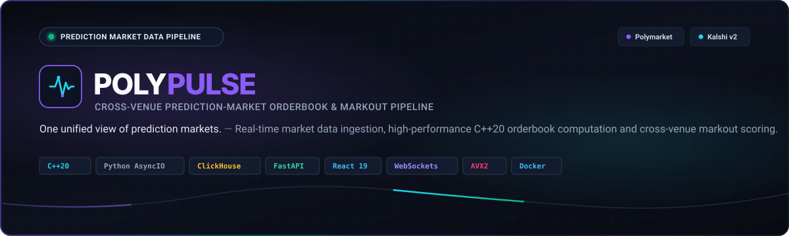
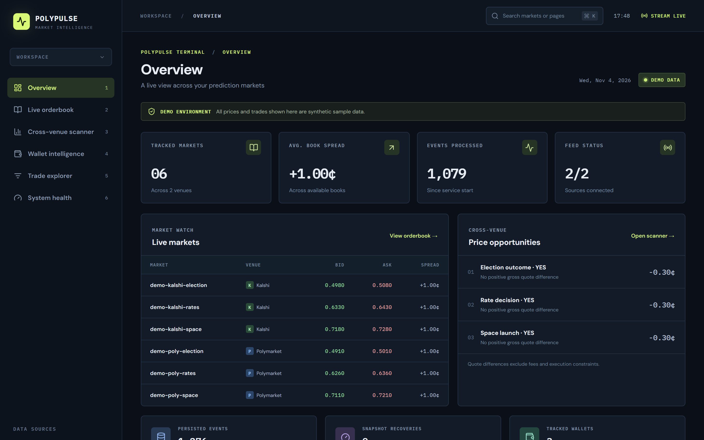
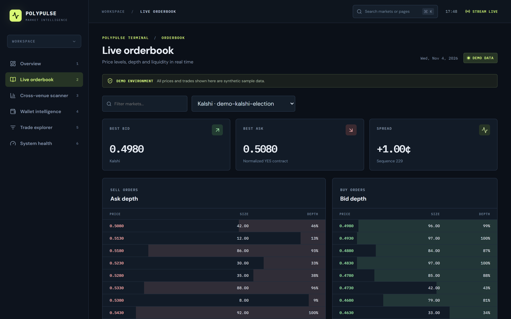
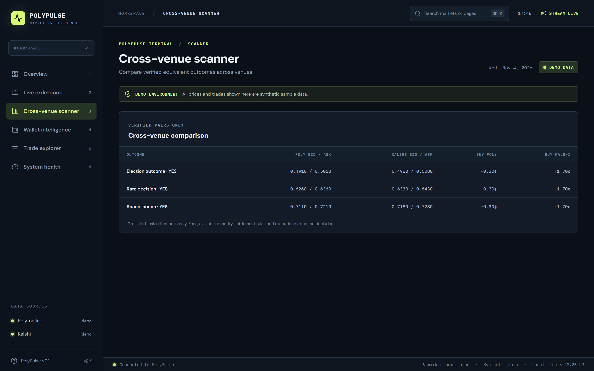
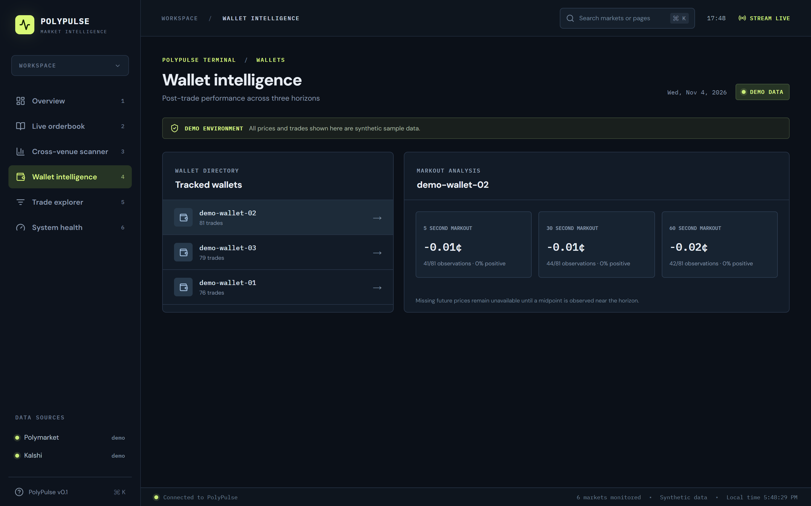
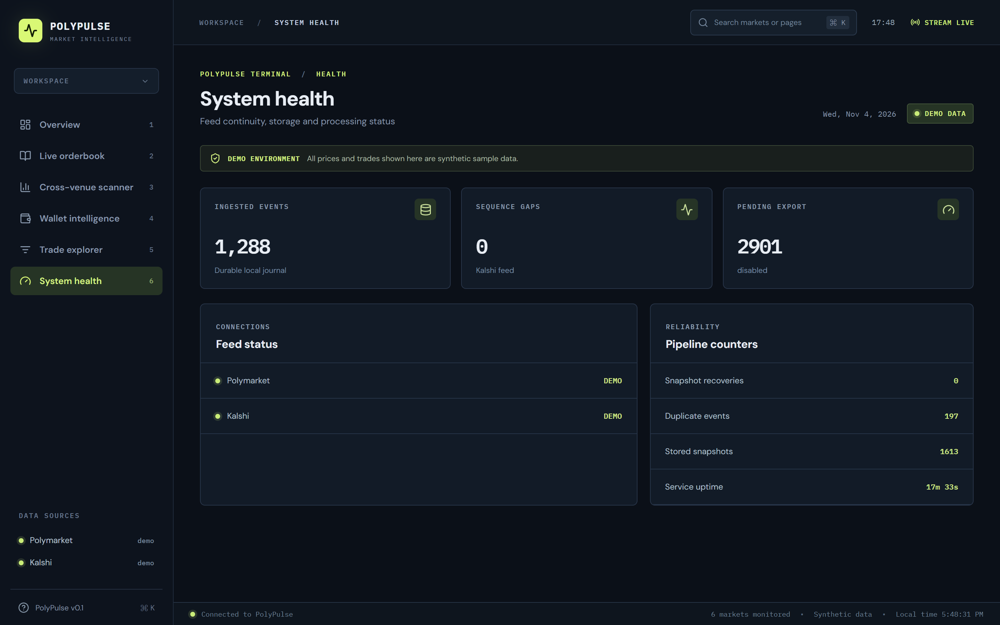
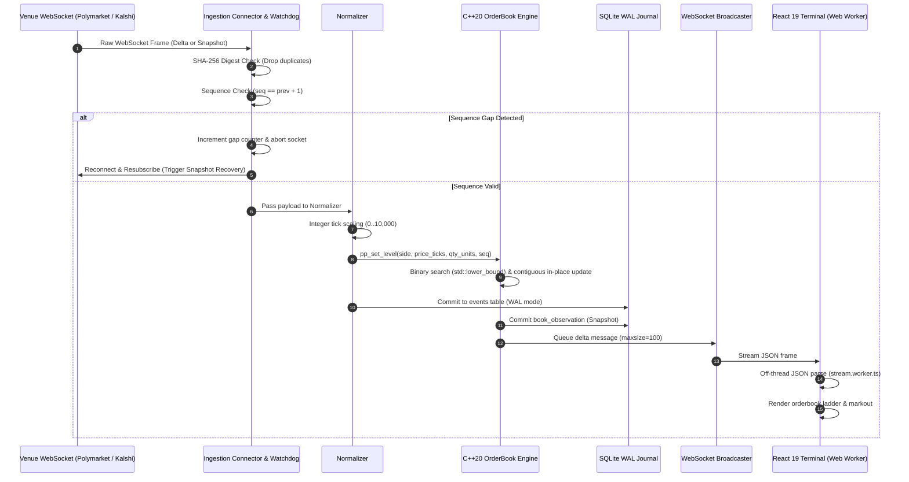
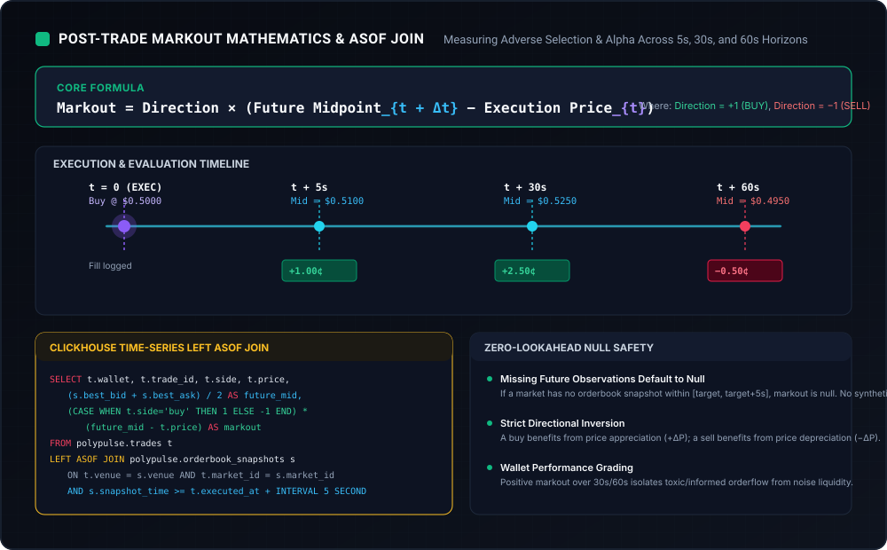
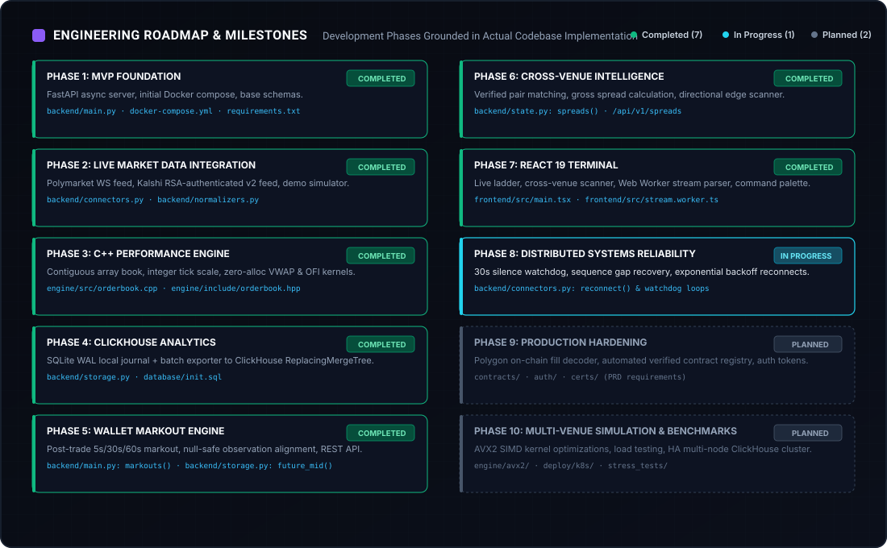

<div align="center">



<br/>

# POLYPULSE

### Cross-Venue Prediction-Market Orderbook &amp; Markout Pipeline

**"One unified view of prediction markets."**
*Real-time market data ingestion, high-performance orderbook computation and cross-venue trading intelligence.*

<br/>

[](docs/orderbook-engine.md)
[](docs/ingestion-pipeline.md)
[](docs/clickhouse-schema.md)
[](docs/api-reference.md)
[](frontend/)
[](docs/deployment.md)
[](LICENSE)

<br/>

[Live Preview](#2-live-preview) •
[Architecture](#4-system-architecture) •
[Benchmarks](#6-performance--benchmarks) •
[Markout Math](#7-markout-mathematics) •
[Installation](#9-installation--quick-start) •
[API Reference](#10-api-documentation) •
[Documentation Index](docs/)

</div>

---

> **Phase 2 status:** See the [live integration, setup, and verification report](docs/phase2.md). The screenshots and performance discussion below describe the earlier synthetic prototype; they are not live exchange measurements. A browser WebSocket connection alone does not establish exchange feed health.

PolyPulse is a working market-data pipeline and analytics terminal for binary prediction markets. It normalizes exchange messages into integer ticks, maintains books in C++20, journals events in SQLite WAL storage, exports batches to ClickHouse, and computes wallet markouts at 5, 30, and 60 seconds. Live operation and performance require further verification as recorded in the Phase 2 report.

---

## Table of Contents

- [1. Repository Identity](#1-repository-identity)
- [2. Live Preview](#2-live-preview)
- [3. Why PolyPulse?](#3-why-polypulse)
- [4. System Architecture](#4-system-architecture)
  - [4.1 Architecture Diagram](#41-architecture-diagram)
  - [4.2 Market-Data Event Lifecycle Sequence](#42-market-data-event-lifecycle-sequence)
- [5. Engineering Features](#5-engineering-features)
- [6. Performance & Benchmarks](#6-performance--benchmarks)
- [7. Markout Mathematics](#7-markout-mathematics)
- [8. Repository Structure](#8-repository-structure)
- [9. Installation & Quick Start](#9-installation--quick-start)
- [10. API Documentation](#10-api-documentation)
- [11. Testing & Verification](#11-testing--verification)
- [12. Roadmap](#12-roadmap)
- [13. Engineering Decisions](#13-engineering-decisions)
- [14. Contributing](#14-contributing)
- [15. License & Disclaimer](#15-license--disclaimer)

---

## 1. Repository Identity

- **Project Name**: PolyPulse
- **Full Title**: Cross-Venue Prediction-Market Orderbook & Markout Pipeline
- **Core Stack**: C++20 · Python AsyncIO · ClickHouse · FastAPI · React 19 · TypeScript · WebSockets · Docker
- **Visual Aesthetic**: Near-black canvas (`#080B12`), Electric Purple (`#8B5CF6`), Cyan (`#22D3EE`), Emerald (`#10B981`), and muted grey slate (`#94A3B8`).

---

## 2. Live Preview

> [!NOTE]
> **Synthetic Demo Mode**: The screenshots below were captured directly from the running PolyPulse terminal in `POLYPULSE_MODE=demo`. The demo mode generates repeatable, pseudo-random orderbook streams across verified prediction pairs (`Election YES`, `Fed Rate Decision YES`, `Space Launch YES`) with simulated executions to test the pipeline end-to-end.

<div align="center">

### Executive Terminal & Market Watch
*Real-time overview of tracked markets, aggregated book spread, local journal counter, and gross arbitrage opportunities.*


<br/><br/>

### High-Frequency Orderbook Ladder
*C++20 sorted level depth, top-of-book quotes, Volume-Weighted Average Price (VWAP), and real-time Order-Flow Imbalance (OFI).*


<br/><br/>

### Cross-Venue Spread Scanner
*Comparing verified equivalent contract pairs between Polymarket and Kalshi with directional gross quote differences.*


<br/><br/>

### Wallet Markout Scoring Engine
*Post-trade adverse selection tracking across 5s, 30s, and 60s evaluation horizons with strict null safety.*


<br/><br/>

### System Health & Pipeline Reliability
*Durable journal statistics, feed watchdog status, sequence gap detection, and ClickHouse exporter telemetry.*


</div>

---

## 3. Why PolyPulse?

Prediction markets have emerged as liquid venues for geopolitical, economic, and cultural forecasting. However, trading and market-making across them presents critical infrastructure challenges:

```
Traditional Challenges in Prediction Market Data:
┌───────────────────────────────┐     ┌───────────────────────────────┐
│       Polymarket CLOB         │     │         Kalshi API v2         │
│  - Floating point decimals    │     │  - Cent/Dollar pricing        │
│  - Outcome tokens (YES / NO)  │     │  - Inverted YES/NO delta      │
│  - Silent WS drops (>30s)     │     │  - Per-SID sequence tracking  │
└───────────────┬───────────────┘     └───────────────┬───────────────┘
                │                                     │
                ▼                                     ▼
        [ Incompatible Formats, Sequence Drops, Unaligned Midpoints ]
                                │
                                ▼
        ┌───────────────────────────────────────────────────┐
        │                 PolyPulse Solution                │
        │  • Canonical millionth-tick normalization          │
        │  • Self-healing watchdog & sequence gap recovery  │
        │  • C++20 contiguous-vector orderbook engine        │
        │  • Local SQLite WAL journal + ClickHouse warehouse│
        │  • Null-safe 5s / 30s / 60s markout evaluation    │
        └───────────────────────────────────────────────────┘
```

1. **Fragmented Feed Protocols**: Polymarket streams market data over public WebSockets without sequence counters; Kalshi requires authenticated Ed25519 or RSA signatures with subscription-scoped sequence IDs (`sid`). PolyPulse uses venue-specific parsers before updating books.
2. **Incompatible Contract Representations**: Polymarket prices represent binary contract prices ($0.00$ to $1.00$); Kalshi YES asks are derived from NO bids ($P_{\text{ask}} = 1.00 - P_{\text{NO bid}}$). PolyPulse uses fixed-point integer ticks at a $10^6$ scale.
3. **Silent WebSocket Dropouts & Packet Loss**: Public exchange sockets frequently hang without triggering standard TCP resets. PolyPulse embeds a 30-second silence watchdog with 10-second active `PING` keepalives and automated sequence gap recovery loops.
4. **Adverse Selection & Wallet Profiling**: In high-velocity binary markets, liquidity providers must identify whether observed trade flow is informed (toxic) or uninformed (noise). PolyPulse solves this with automated post-trade markout evaluation using ClickHouse `LEFT ASOF JOIN` queries.

---

## 4. System Architecture

### 4.1 Architecture Diagram

```mermaid
flowchart TD
    subgraph Venues ["1. Market Feeds"]
        PM["Polymarket CLOB<br/>(Public WebSocket)"]
        KL["Kalshi Trade API v2<br/>(Ed25519 / RSA Auth WebSocket)"]
        PG["Polygon V2 Fills<br/>(confirmed RPC polling)"]
    end

    subgraph Ingestion ["2. Ingestion & Reliability Layer (Python AsyncIO)"]
        WS_POOL["AsyncIO Client Pool"]
        WATCHDOG["30s Silence Watchdog & Keepalive"]
        DEDUP["SHA-256 Rolling Deduplication (10,000 Deque)"]
        GAP_DET["Sequence Continuity Evaluator"]
        NORM["Normalizer: Fixed-Point Ticks (1/10,000 unit)"]
    end

    subgraph Processing ["3. High-Performance Engine (C++20)"]
        FFI["C FFI Interface (extern 'C')"]
        OB_VEC["std::vector&lt;PriceLevel&gt;<br/>Contiguous Memory Layout"]
        VWAP_KERN["VWAP Kernel (Extended Precision)"]
        OFI_KERN["Order-Flow Imbalance Kernel"]
    end

    subgraph Storage ["4. Storage & Persistence Tier"]
        SQLITE[("SQLite Journal (WAL Mode)<br/>polypulse.db")]
        EXPORTER["Async HTTP Micro-Batch Exporter"]
        CLICKHOUSE[("ClickHouse OLAP<br/>ReplacingMergeTree & ASOF JOIN")]
    end

    subgraph Presentation ["5. Presentation & Analytics"]
        API["FastAPI REST Gateway (/api/v1/*)"]
        WS_BROADCAST["WebSocket Broadcaster (/ws/markets, /ws/wallets)"]
        WORKER["Web Worker Stream Parser (off-thread)"]
        TERMINAL["React 19 Terminal (Orderbook, Scanner, Wallets)"]
    end

    PM --> WS_POOL
    KL --> WS_POOL
    PG -.-> WS_POOL

    WS_POOL --> WATCHDOG
    WATCHDOG --> DEDUP
    DEDUP --> GAP_DET
    GAP_DET -->|Valid Sequence (seq == prev + 1)| NORM
    GAP_DET -->|Gap Detected (seq > prev + 1)| WS_POOL

    NORM -->|ctypes Bridge| FFI
    FFI --> OB_VEC
    OB_VEC --> VWAP_KERN
    OB_VEC --> OFI_KERN

    NORM -->|Insert Raw Event| SQLITE
    OB_VEC -->|Insert Snapshot| SQLITE
    SQLITE --> EXPORTER
    EXPORTER --> CLICKHOUSE

    OB_VEC -->|Push Level Update| WS_BROADCAST
    WS_BROADCAST --> WORKER
    WORKER --> TERMINAL
    API --> SQLITE
    API --> TERMINAL
```

### 4.2 Market-Data Event Lifecycle Sequence



---

## 5. Engineering Features

### 1. Multi-Venue Market Ingestion
- **What it does**: Ingests real-time orderbook snapshots and incremental price-level deltas from Polymarket and Kalshi concurrently.
- **Why it exists**: Fragmented liquidity requires traders to maintain multiple persistent connections with radically different protocols.
- **How it works**: Uses Python AsyncIO connection tasks managed by the FastAPI lifecycle. Kalshi requests use Ed25519 or RSA-PSS signatures.
- **Implementation**: [backend/live.py](backend/live.py), [backend/events.py](backend/events.py).

### 2. Self-Healing Data Pipeline
- **What it does**: Automatically recovers from network disconnects, server resets, dropped frames, and sequence gaps.
- **Why it exists**: If an incremental orderbook delta is dropped, the local orderbook silently drifts out of sync with exchange reality.
- **How it works**: 
  - A Polymarket heartbeat watchdog sends `PING` frames and checks for `PONG`; stale market books are hidden.
  - A sequence tracker detects gaps ($\text{seq} > \text{prev} + 1$), increments telemetry counters, tears down the socket, and re-subscribes to force a fresh snapshot.
  - Deterministic event IDs and SQLite uniqueness prevent duplicate logical journal writes.
- **Implementation**: [backend/live.py](backend/live.py), [backend/durable.py](backend/durable.py).

### 3. Unified C++20 Orderbook Engine
- **What it does**: Maintains contiguous price levels, computes Top-of-Book quotes, and evaluates mathematical metrics.
- **Why it exists**: Pure Python dictionaries or objects incur high interpreter overhead, heap fragmentation, and garbage collection pauses.
- **How it works**: Implemented in C++20 using `std::vector<PriceLevel>`. Prices and quantities are 64-bit integers scaled by $10^6$. Level search uses `std::lower_bound`; insertion and deletion can move subsequent levels.
- **Implementation**: [engine/include/orderbook.hpp](file:///d:/PROJECTS/Polypulse/engine/include/orderbook.hpp), [engine/src/orderbook.cpp](file:///d:/PROJECTS/Polypulse/engine/src/orderbook.cpp).

### 4. VWAP and Imbalance Calculations
- **What it does**: Computes depth-weighted prices and bid/ask imbalance using scalar arithmetic.
- **Current Status**: The current implementation utilizes scalar arithmetic with 80-bit extended precision (`long double`) in [engine/src/orderbook.cpp](file:///d:/PROJECTS/Polypulse/engine/src/orderbook.cpp). Hand-crafted AVX2 SIMD kernels (`_mm256_add_pd`, `_mm256_mul_pd`) are scheduled for Phase 10 / production hardening.
- **Implementation Details**: See [docs/benchmarking.md](file:///d:/PROJECTS/Polypulse/docs/benchmarking.md).

### 5. Cross-Venue Intelligence & Arbitrage Scanner
- **What it does**: Computes real-time cross-venue bid-ask spreads, executable depth, and cost-adjusted cross-venue opportunities across operator-verified contract pairs.
- **Why it exists**: Fragmented binary liquidity across Polymarket and Kalshi creates recurring mispricings, but naive title matching leads to severe basis risk and phantom arbitrage.
- **Phase 6 Implementation Highlights**:
  - **Seven-Dimension Contract Registry**: Stores Polymarket asset/token ID, Kalshi ticker, canonical event and outcome, equivalence mapping, resolution criteria and source, expiration and settlement details, verification status, reviewer identity, and review timestamp.
  - **Zero Title-Only Matching Invariant**: Strictly rejects automated string similarity matching; requires explicit comparison of authoritative settlement conditions.
  - **Dual Equivalence Topologies**:
    - **Direct Mapping** ($Poly_{\text{YES}} \equiv Kalshi_{\text{YES}}$): Long Poly / Short Kalshi ($P^{\text{kalshi}}_{\text{bid}} - P^{\text{poly}}_{\text{ask}}$) and Long Kalshi / Short Poly ($P^{\text{poly}}_{\text{bid}} - P^{\text{kalshi}}_{\text{ask}}$).
    - **Inverse Mapping** ($Poly_{\text{YES}} \equiv Kalshi_{\text{NO}}$): Synthetic complementary payoff parity Long Both ($1.00 - [P^{\text{poly}}_{\text{ask}} + P^{\text{kalshi}}_{\text{ask}}]$) and Short Both ($[P^{\text{poly}}_{\text{bid}} + P^{\text{kalshi}}_{\text{bid}}] - 1.00$).
  - **Official Fee Models & Two-Leg Slippage**:
    - **Polymarket Official Taker Fee Formula**: $\text{fee} = \text{round}(C \times r \times [P(1-P)]^e, 5)$ using token-specific CLOB `GET /clob-markets/{condition_id}` fee details (`fd.r/e/to`), a complete Gamma schedule, or category fallback (Sports `0.05`). Explicit `fd: null` is fee-free only with corroborating `feesEnabled=false` market metadata. `/fee-rate` `base_fee` is basis-point metadata, not a complete curve. Missing or invalid configurations give `fee_status = "unknown"` and cannot claim an executable net spread.
    - **Kalshi Official CFTC Schedule (`v2026.2`)**: The scanner uses `POLYPULSE_FEE_VERSION` (default `v2026.2`) for every direct and inverse evaluation, applying series multipliers (`0.07` standard, `0.035` index) with order-level `ceil_whole_cents` rounding.
    - **Two-Leg Slippage Buffer**: Applies configurable slippage independently across both execution legs. Depth-size net spreads use each filled level's price and quantity for fees, with Decimal rounding; the top quote is capped at first-level liquidity.
  - **Strict Scanner Gating**: Only pairs with `verification_status == 'verified'` enter the executable scanner; unverified, rejected, expired, unknown-fee, or crossed-book pairs are strictly excluded from executable status.
  - **Operator Authentication**: Preserves header-based (`X-Operator-Key`) and Bearer token authentication on all mutating endpoints (`PUT /contracts`, `POST /verify`, `DELETE`).
- **Implementation & Specifications**: [backend/scanner.py](backend/scanner.py), [backend/fees.py](backend/fees.py), [backend/state.py](backend/state.py), [docs/phase6.md](docs/phase6.md), and [docs/phase6_results.md](docs/phase6_results.md).

### 6. Wallet Markout Scoring & Microstructure Audit
- **What it does**: Evaluates adverse selection on executed trades by comparing execution price to subsequent market midpoints across 5s, 30s, and 60s observation horizons.
- **Why it exists**: Critical for liquidity providers to distinguish informed flow (alpha) from uninformed noise, quantify maker adverse selection, and monitor trader performance.
- **Phase 5 Correctness Audit Highlights**:
  - **Zero Fabrication**: Public CLOB and Kalshi market data feeds never fabricate synthetic counterparties or wallet IDs.
  - **Verified On-Chain Attribution**: Decodes individual maker fills from Polygon CTF Exchange V2 and Neg Risk Exchange V2 contracts.
  - **Summary Event Exclusion**: Taker-order summary logs (`taker == exchange_address`) and exchange contract addresses (`0x4bfb...`, `0xc5d5...`) are classified and filtered out to prevent phantom wallet attribution.
  - **Match Types**: Supports Complementary, MINT (both maker and taker are buyers), MERGE (both maker and taker are sellers), and strictly rejects unresolved matches.
  - **Address Normalization**: Validates exact 20-byte addresses, checks leading zero-padding in 32-byte topics, and provides EIP-55 checksumming (`to_checksum_address`) for user display.
  - **Precision Preservation**: Preserves 256-bit `token_id` integers as lossless decimal strings.
  - **Timing & Invariants**: Enforces an observation tolerance window ($[T_{\text{target}} - 0.5\text{s}, T_{\text{target}} + 5.0\text{s}]$), flags stale quotes ($> 10\text{s}$ latency), rejects crossed quotes ($P_{\text{ask}} \le P_{\text{bid}}$), and delays finalized unavailable classification until $T_{\text{target}} + 10\text{s}$.
  - **ClickHouse Partition Stability**: `trade_markouts` is partitioned by `toYYYYMM(trade_timestamp)` so cross-month recomputations deduplicate deterministically within the trade's immutable month partition.
  - **Sample Size Qualification**: Enforces sample size filters ($N \ge 5$) independently per horizon based on available observations (`available_count >= min_trades`).
- **Implementation & Specifications**: [backend/wallet.py](backend/wallet.py), [backend/markout.py](backend/markout.py), [docs/phase5.md](docs/phase5.md), and [docs/verification/phase5-live-audit.json](docs/verification/phase5-live-audit.json).

### 7. ClickHouse Time-Series Analytics
- **What it does**: Provides high-throughput columnar storage for historical market events and snapshots.
- **Why it exists**: Relational databases degrade when querying millions of high-frequency tick records.
- **How it works**: An asynchronous exporter sends bounded batches from the SQLite WAL journal into ClickHouse MergeTree-family tables using HTTP `JSONEachRow`. Analytical counts use unique event IDs because physical retry rows can coexist before merges.
- **Implementation**: [backend/durable.py](backend/durable.py), [database/init.sql](database/init.sql).

### 8. Real-Time React 19 Terminal
- **What it does**: Renders orderbook depth, cross-venue scanner, wallet intelligence, and system diagnostics with explicit demo/live status.
- **Why it exists**: High-frequency WebSocket JSON parsing on the main browser thread causes interface jank.
- **How it works**: Offloads stream parsing to an isolated Web Worker (`stream.worker.ts`), posting structured updates to the React state tree.
- **Implementation**: [frontend/src/main.tsx](file:///d:/PROJECTS/Polypulse/frontend/src/main.tsx), [frontend/src/stream.worker.ts](file:///d:/PROJECTS/Polypulse/frontend/src/stream.worker.ts).

---

## 6. Performance & Benchmarks

> [!NOTE]
> **Phase 3 Empirical Verification:** All measurements below were captured directly from the C++20 microbenchmark harness on real hardware (AMD Ryzen 7 7735HS, GCC 16.2.0, `-std=c++20 -O3`) using a batched timing methodology ($200\text{ ops/batch} \times 5\,000\text{ batches} = 1\,000\,000\text{ operations per test}$) to eliminate the 100 ns clock quantization artifact on Windows. PolyPulse does not invent or fabricate benchmark figures.

### Phase 3 Engine Measurements

| Target Operation | Throughput | p50 Latency | p95 Latency | p99 Latency | Avg Latency | Status |
| :--- | :--- | :--- | :--- | :--- | :--- | :--- |
| **In-Place Level Update (Flat Vector, 10-level book)** | **56.39M ops/sec** | **17.00 ns** | **27.00 ns** | **33.50 ns** | **17.73 ns** | **Active Implementation** |
| **Level Updates (20-level depth)** | **54.01M ops/sec** | **16.50 ns** | **28.00 ns** | **35.00 ns** | **18.52 ns** | **Active Implementation** |
| **Level Updates (50-level depth)** | **46.26M ops/sec** | **18.00 ns** | **36.00 ns** | **66.00 ns** | **21.62 ns** | **Active Implementation** |
| **Insert + Delete Level (Flat Vector with memmove)** | **42.48M ops/sec** | **21.50 ns** | **42.00 ns** | **47.50 ns** | **23.54 ns** | **3.66x faster than `std::map`** |
| **Insert + Delete Level (`std::map` with heap alloc)** | 11.60M ops/sec | 72.00 ns | 82.50 ns | 305.00 ns | 86.19 ns | Dynamic heap baseline |
| **Full Snapshot Replacement (20 levels total)** | **7.28M ops/sec** | **155.00 ns** | **172.00 ns** | **356.00 ns** | **137.38 ns** | **Active Implementation** |
| **Top-of-Book Quote Read (`front()` lookup)** | **281.24M ops/sec** | **3.00 ns** | **4.50 ns** | **6.00 ns** | **3.56 ns** | **Active Implementation** |
| **Single-Lot VWAP (128-bit Integer Accumulator)** | **79.97M ops/sec** | **12.50 ns** | **17.00 ns** | **19.00 ns** | **12.51 ns** | **Active Implementation** |
| **Batch VWAP (8 Lots - Scalar Baseline)** | **9.11M ops/sec** | **109.50 ns** | **140.00 ns** | **241.50 ns** | **109.74 ns** | Scalar fallback |
| **Batch VWAP (8 Lots - AVX2 256-bit SIMD)** | **13.53M ops/sec** | **77.00 ns** | **91.50 ns** | **150.00 ns** | **73.92 ns** | **Active SIMD Kernel (1.48x speedup)** |
| **Order Flow Imbalance (OFI + Cumulative Read)** | **934.93M ops/sec** | **1.00 ns** | **2.50 ns** | **3.00 ns** | **1.07 ns** | **Active Implementation** |
| **Spread Analytics (Mid, Spread Ticks, Bps)** | **169.55M ops/sec** | **6.00 ns** | **8.00 ns** | **9.00 ns** | **5.90 ns** | **Active Implementation** |
| **Cross-Venue Spread (2 Independent Books)**| **73.76M ops/sec** | **11.00 ns** | **20.50 ns** | **38.50 ns** | **13.56 ns** | **Active Implementation** |

### Memory Footprint & Allocation Invariants
- **Static Memory per `OrderBook` instance**: **112 bytes** (stack size).
- **Struct Sizes**: `PriceLevel`: 16 bytes, `Quote`: 40 bytes, `SpreadAnalytics`: 48 bytes (padded), `CrossSpreadAnalytics`: 40 bytes.
- **Dynamic Heap Memory**: 4,096 bytes pre-allocated on construction (`reserve(128)` levels per side $\times 16$ bytes $\times 2$ sides).
- **Steady-State Allocations**: **ZERO** dynamic heap allocations during streaming tick updates or snapshot replacements within capacity $\le 128$ levels.
- **Cache Locality**: 4 complete `PriceLevel` structs (16 bytes each) packed into a single 64-byte L1 CPU cache line.

### Reproducible Benchmark Command
You can reproduce these exact measurements on your machine with:

```powershell
python scripts/benchmark.py
```
*(Or compile natively with `g++ -std=c++20 -O3 -I engine/include engine/src/orderbook.cpp engine/benchmarks/benchmark.cpp -o engine/build/benchmark.exe` and execute).*

---

## 7. Markout Mathematics

Post-trade markout evaluates execution quality by tracking midpoint trajectory after fill execution:

$$\text{Markout}(\Delta t) = \text{Direction} \times (P_{\text{mid}}(t + \Delta t) - P_{\text{exec}})$$

$$\text{Markout (bps)} = \left( \frac{\text{Markout}(\Delta t)}{P_{\text{exec}}} \right) \times 10{,}000 \quad (P_{\text{exec}} > 0)$$

Where:
- $\text{Direction} = +1$ for **BUY** orders, $-1$ for **SELL** orders.
- $P_{\text{exec}}$ is the execution price.
- $P_{\text{mid}}(t + \Delta t) = \frac{\text{Best Bid}(t + \Delta t) + \text{Best Ask}(t + \Delta t)}{2}$.
- Evaluated across standardized horizons: $\Delta t \in \{5\text{s}, 30\text{s}, 60\text{s}\}$.

> [!IMPORTANT]
> **Adverse Selection vs. Realized P&L**: Markout strictly measures post-trade market drift and adverse selection relative to execution price. It does **not** represent closed portfolio P&L, inventory carrying cost, or settlement payout.
>
> **Microstructure Validation Rules**:
> 1. **Crossed / Locked Books**: Snapshots with $P_{\text{best\_ask}} \le P_{\text{best\_bid}}$ or quotes $\le 0$ are marked as `crossed` and rejected from midpoint calculations.
> 2. **Observation Tolerance Window**: Midpoints are sampled within $[t_{\text{target}} - 0.5\text{s}, t_{\text{target}} + 5.0\text{s}]$. If no observation exists, status is `unavailable`. If timestamp latency $> 10\text{s}$, status is `stale`.
> 3. **Zero Fabrication Invariant**: Public Polymarket CLOB and Kalshi feeds do **not** carry wallet addresses and are **never** fabricated. Wallet attribution is strictly derived from verified Polygon CTF Exchange V2 maker/taker logs and demo execution.
> 4. **Ranking Guardrail**: Leaderboards enforce a minimum sample size threshold ($N_{\text{trades}} \ge 5$) so 1-trade noise does not dominate alpha rankings.

<div align="center">

</div>

### Worked Numerical Example

| Trade Parameter | Scenario A: Informed Buy | Scenario B: Uninformed Sell |
| :--- | :--- | :--- |
| **Execution** | Buy 100 YES @ **\$0.5000** | Sell 50 YES @ **\$0.5200** |
| **Future Mid at $t + 5\text{s}$** | \$0.5100 | \$0.5180 |
| **5-Second Markout** | $+1 \times (0.5100 - 0.5000) = \mathbf{+1.00\text{¢}\ (+200\text{ bps})}$ | $-1 \times (0.5180 - 0.5200) = \mathbf{+0.20\text{¢}\ (+38.5\text{ bps})}$ |
| **Future Mid at $t + 30\text{s}$** | \$0.5250 | \$0.5420 |
| **30-Second Markout** | $+1 \times (0.5250 - 0.5000) = \mathbf{+2.50\text{¢}\ (+500\text{ bps})}$ | $-1 \times (0.5420 - 0.5200) = \mathbf{-2.20\text{¢}\ (-423.1\text{ bps})}$ |
| **Future Mid at $t + 60\text{s}$** | \$0.4950 | \$0.5500 |
| **60-Second Markout** | $+1 \times (0.4950 - 0.5000) = \mathbf{-0.50\text{¢}\ (-100\text{ bps})}$ | $-1 \times (0.5500 - 0.5200) = \mathbf{-3.00\text{¢}\ (-576.9\text{ bps})}$ |

### Time-Series Alignment via ClickHouse `LEFT ASOF JOIN`
```sql
SELECT
    t.trade_id, t.wallet, t.side, t.price,
    (s.best_bid + s.best_ask) / 2 AS future_mid,
    (CASE WHEN t.side = 'buy' THEN 1 ELSE -1 END) * 
    (((s.best_bid + s.best_ask) / 2) - t.price) AS markout
FROM polypulse.trades t
LEFT ASOF JOIN polypulse.orderbook_snapshots s
    ON t.venue = s.venue AND t.market_id = s.market_id
   AND s.snapshot_time >= t.executed_at + INTERVAL 5 SECOND;
```

---

## 8. Repository Structure

```text
polypulse/
├── .github/
│   ├── workflows/
│   │   └── ci.yml                 # Multi-platform CI (C++ tests, Python tests, Frontend build)
│   ├── ISSUE_TEMPLATE/
│   │   ├── bug_report.yml         # Structured GitHub bug reporting schema
│   │   ├── feature_request.yml    # Architectural proposal schema
│   │   └── config.yml             # Issue navigation & security links
│   └── PULL_REQUEST_TEMPLATE.md   # PR validation & invariant checklist
├── backend/
│   ├── analytics.py               # ClickHouse parameterized historical analytics client & telemetry
│   ├── canonical.py               # Millionth-tick canonical price & quote normalization
│   ├── connectors.py              # Polymarket CLOB & Kalshi v2 WebSocket feeds + Demo generator
│   ├── durable.py                 # SQLite WAL durable journal & micro-batch ClickHouse exporter
│   ├── engine.py                  # Python ctypes bridge to C++20 shared library
│   ├── events.py                  # Canonical millionth-tick event models and venue parsers
│   ├── fees.py                    # Versioned fee engine (Kalshi CFTC schedule, Poly fees, slippage buffer)
│   ├── live.py                    # Production exchange connectors, watchdog, and REST reconciliation
│   ├── logging_config.py          # Structured JSON logging and credential redaction
│   ├── main.py                    # FastAPI application, REST endpoints, and WebSocket hubs
│   ├── markout.py                 # Multi-horizon execution markout & adverse selection engine
│   ├── notifications.py           # Cross-venue notification engine with per-pair cooldowns
│   ├── polygon.py                 # Polygon V2 OrderFilled continuous poller and decoder
│   ├── scanner.py                 # Cross-venue spread, ladder VWAP, and 8-state opportunity machine
│   ├── state.py                   # MarketState manager, spread scanner, and listener queues
│   ├── wallet.py                  # Wallet attribution models, address normalization & maker/taker extraction
│   ├── Dockerfile                 # Backend container definition
│   └── __init__.py
├── database/
│   └── init.sql                   # ClickHouse DDL (ReplacingMergeTree, AggregatingMergeTree MVs, Codecs, TTLs)
├── docs/
│   ├── api-reference.md           # Complete REST and WebSocket API specification
│   ├── architecture.md            # System architecture and data flow documentation
│   ├── benchmarking.md            # Empirical performance methodology and measurements
│   ├── clickhouse-schema.md       # ClickHouse table design, partitioning, and ASOF JOIN
│   ├── deployment.md              # Production deployment, Docker Compose, and environment guides
│   ├── ingestion-pipeline.md      # Protocol documentation for Polymarket & Kalshi feeds
│   ├── markout-engine.md          # Markout mathematics, adverse selection, and null safety
│   ├── orderbook-engine.md        # C++20 orderbook design, cache locality, and FFI bindings
│   ├── phase2.md                  # Phase 2 live verification and closure report
│   ├── phase3.md                  # Phase 3 C++20 orderbook engine audit & verification report
│   ├── phase4.md                  # Phase 4 ClickHouse analytics architecture & verification report
│   ├── phase5.md                  # Phase 5 Wallet intelligence & markout analytics architecture report
│   ├── phase6.md                  # Phase 6 Cross-venue intelligence architecture & verification report
│   ├── phase6_execution.md        # Phase 6 Execution log & stage progress tracker
│   ├── phase6_results.md          # Phase 6 Empirical ground-truth results & mathematical proofs report
│   ├── system-design.md           # Deep-dive trade-off analysis and quantitative constraints
│   ├── testing.md                 # Testing strategy, verification commands, and test suites
│   └── assets/                    # Animated SVG diagrams and genuine application screenshots
├── engine/
│   ├── benchmarks/
│   │   └── benchmark.cpp          # Microbenchmark harness (throughput, p50/p95/p99 latency)
│   ├── include/
│   │   └── orderbook.hpp          # C++20 OrderBook class & C-linkage export signatures
│   ├── src/
│   │   └── orderbook.cpp          # Orderbook implementation, VWAP, and OFI kernels
│   └── tests/
│       └── orderbook_test.cpp     # Unit tests verifying C++ orderbook invariants
├── frontend/
│   ├── src/
│   │   ├── main.tsx               # React 19 trading terminal UI & ClickHouse analytics view
│   │   ├── stream.worker.ts       # Off-main-thread Web Worker JSON stream parser
│   │   └── style.css              # Dark technical design tokens and layout styling
│   ├── Dockerfile                 # Nginx frontend container definition
│   ├── index.html                 # Single-page application entrypoint
│   ├── nginx.conf                 # Nginx production reverse proxy configuration
│   ├── package.json               # Node.js dependencies
│   ├── tsconfig.json              # TypeScript compilation configuration
│   └── vite.config.ts             # Vite build pipeline
├── scripts/
│   ├── benchmark.py               # Reproducible C++ benchmark build and execution script
│   ├── benchmark_clickhouse.py    # Automated ClickHouse analytics query benchmark suite
│   ├── benchmark_cross_venue.py   # Reproducible Phase 6 cross-venue benchmark suite
│   └── build_engine.py            # C++ compiler build script for shared library and tests
├── tests/
│   ├── test_clickhouse_analytics.py # ClickHouse schema, deduplication, and MV integration tests
│   ├── test_cross_venue.py        # Cross-venue equivalence, ladder VWAP, fee engine & state machine tests
│   ├── test_phase2.py             # Live feeds, sequence gaps, and reconciliation tests
│   ├── test_phase3.py             # C++20 orderbook FFI, AVX2 SIMD, and OFI tests
│   ├── test_pipeline.py           # Python unittest suite for normalization and durability
│   └── test_wallet_markout.py     # Wallet attribution, maker/taker, and markout analytics tests
├── .dockerignore                  # Docker build context exclusion rules
├── .env.example                   # Annotated environment variable configuration template
├── .gitignore                     # Git tracking exclusions
├── CHANGELOG.md                   # Chronological version history (Keep a Changelog standard)
├── CODE_OF_CONDUCT.md             # Contributor Covenant Code of Conduct v2.1
├── CONTRIBUTING.md                # Development setup, branch conventions, and PR guidelines
├── docker-compose.yml             # Multi-service stack (api, frontend, clickhouse)
├── LICENSE                        # MIT Open Source License
├── requirements.txt               # Python production dependencies
└── SECURITY.md                    # Security policy and responsible vulnerability disclosure
```

---

## 9. Installation & Quick Start

### Prerequisites
- **Python 3.11+**
- **Node.js 20+** and **npm**
- **C++20 Compiler**: `g++` (GCC 11+) or `clang++` (Clang 13+)
- **Docker Desktop** (optional, for ClickHouse)

### 1. Clone the Repository
```powershell
git clone https://github.com/shatwiks/polypulse.git
cd polypulse
```

### 2. Configure Environment Variables
```powershell
Copy-Item .env.example .env
```
*(Default settings run in `POLYPULSE_MODE=demo` without requiring API keys).*

### 3. Install Python Dependencies
```powershell
python -m venv .venv
.\.venv\Scripts\Activate.ps1
pip install -r requirements.txt
```

### 4. Build the C++20 Engine
```powershell
python scripts/build_engine.py
```
*Generates `engine/build/polypulse.dll` (Windows) or `polypulse.so` (Linux).*

### 5. Start ClickHouse (Optional)
```powershell
docker compose up -d clickhouse
```
*Set `CLICKHOUSE_URL=http://localhost:8123` in `.env` to enable remote export.*

### 6. Start the Backend API
```powershell
python -m uvicorn backend.main:app --reload --port 8000
```

### 7. Start the Frontend Terminal
In a new terminal window:
```powershell
cd frontend
npm install
npm run dev
```

### 8. Open the Dashboard
Navigate to **http://localhost:5173** in your browser.

---

## 10. API Documentation

Interactive Swagger documentation is available at `http://localhost:8000/docs`.

| Method | Endpoint | Description | Query / Body Parameters |
| :--- | :--- | :--- | :--- |
| `GET` | `/api/v1/markets` | List all tracked markets & active quotes | — |
| `GET` | `/api/v1/markets/{market_id}/orderbook` | Get full orderbook price-level ladder | `venue=polymarket\|kalshi` |
| `GET` | `/api/v1/markets/{market_id}/spread` | Get spread for specific verified pair | — |
| `GET` | `/api/v1/spreads` | List all verified cross-venue spreads | — |
| `GET` | `/api/v1/contracts` | List operator-reviewed contract pairs | — |
| `PUT` | `/api/v1/contracts` | Save contract review *(Operator authenticated)* | `X-Operator-Key` header, JSON pair review |
| `DELETE` | `/api/v1/contracts/{poly_id}/{ticker}` | Remove contract review *(Operator authenticated)* | `X-Operator-Key` header |
| `GET` | `/api/v1/cross-venue/pairs` | List cross-venue contract pairs with verification filter | `status=verified\|unverified\|all` |
| `GET` | `/api/v1/cross-venue/pairs/{pair_id}` | Retrieve individual cross-venue pair specifications | — |
| `PUT` | `/api/v1/cross-venue/pairs/{pair_id}/review` | Submit/update operator contract review *(Authenticated)* | `X-Operator-Key` header |
| `GET` | `/api/v1/cross-venue/spreads` | Live scanned spreads across all verified pairs | — |
| `GET` | `/api/v1/cross-venue/opportunities` | Filtered active arbitrage opportunities (gross/net spread) | `min_net_spread`, `state` |
| `GET` | `/api/v1/cross-venue/opportunities/{opp_id}` | Retrieve single opportunity detail and fill capacity | — |
| `GET` | `/api/v1/cross-venue/fees` | Active fee schedule versions and fee calculation breakdown | — |
| `GET` | `/api/v1/cross-venue/analytics` | Historical cross-venue analytics & duration stats | `horizon_hours` |
| `GET` | `/api/v1/cross-venue/notifications` | Audit log of recent cross-venue notification events | `limit` |
| `GET` | `/api/v1/health` | Feed status, journal stats, sequence counters | — |
| `GET` | `/api/v1/metrics` | System diagnostic metrics (aliased to health) | — |
| `POST` | `/api/v1/trades` | Ingest trade execution *(Demo mode only)* | JSON: `trade_id`, `wallet`, `venue`, `price`, etc. |
| `GET` | `/api/v1/trades` | List observed trade executions & maker fills | — |
| `GET` | `/api/v1/wallets` | List tracked wallets, trade counts & attribution split | — |
| `GET` | `/api/v1/wallets/{address}` | Wallet profile (first/last seen, total volume, notional) | — |
| `GET` | `/api/v1/wallets/{address}/trades` | Paginated wallet executions with maker/taker attribution | `limit`, `offset`, `venue`, `market_id` |
| `GET` | `/api/v1/wallets/{address}/markouts` | Multi-horizon markout analysis (5s, 30s, 60s) in $ and bps | `horizon=5\|30\|60`, `venue`, `market_id` |
| `GET` | `/api/v1/wallets/{address}/performance` | Detailed side breakdown (Buy vs. Sell) and drift metrics | `calc_version` |
| `GET` | `/api/v1/analytics/wallet-rankings` | Leaderboard ranked by avg markout bps with $N \ge 5$ guardrail | `horizon=5\|30\|60`, `min_trades`, `limit` |
| `GET` | `/api/v1/analytics/markout-distribution` | Microstructure adverse selection quantiles (P10–P90) | `horizon=5\|30\|60`, `venue`, `market_id` |

### WebSocket Streams

| WebSocket URL | Protocol Description |
| :--- | :--- |
| `ws://localhost:8000/ws/markets` | Emits initial market snapshot upon handshake, followed by real-time `book` deltas and 5s `health` frames. |
| `ws://localhost:8000/ws/cross-venue` | Emits real-time cross-venue arbitrage frames, verified pair statuses, and executable depth updates. |
| `ws://localhost:8000/ws/wallets` | Streams periodic aggregated trade counts per wallet every 5 seconds. |

*Full request/response schemas: [docs/api-reference.md](docs/api-reference.md).*

---

## 11. Testing & Verification

Current verification: 134 Python test items (133 passed, 1 live ClickHouse test skipped), C++20 orderbook tests passed, and the frontend production build passed. CLOB fee edge cases and depth costs were tested with deterministic fixtures; this run did not verify a live CLOB fee response, live Kalshi connectivity, or execute orders.

```powershell
# 1. C++ Engine Unit Tests
python scripts/build_engine.py --test

# 2. Python Test Suite (134 items across live feeds, C++ FFI, ClickHouse, Markouts & Cross-Venue)
python -m pytest tests/

# 3. Cross-Venue Intelligence & Arbitrage Scanner Tests (27 tests)
python -m pytest tests/test_cross_venue.py -v

# 4. Wallet Intelligence & Markout Analytics Tests (28 tests)
python -m pytest tests/test_wallet_markout.py -v

# 5. ClickHouse Analytics Integration Tests (16 tests)
python -m pytest tests/test_clickhouse_analytics.py -v

# 6. Frontend TypeScript Typecheck & Production Build
cd frontend; npm run build; cd ..

# 7. Cross-Venue Performance & Microbenchmark Suite
python scripts/benchmark_cross_venue.py

# 8. C++20 Orderbook Microbenchmark Suite
python scripts/benchmark.py

# 9. ClickHouse Analytics Query Benchmark
python scripts/benchmark_clickhouse.py
```

*Complete test documentation: [docs/testing.md](docs/testing.md).*

---

## 12. Roadmap

<div align="center">

</div>

- [x] **Phase 1: MVP Foundation** — FastAPI AsyncIO core, project scaffolding, base models.
- [x] **Phase 2: Live Market Data Integration** — Polymarket WS + REST reconciliation verified; Polygon continuous poller verified; ClickHouse outage replay verified; Kalshi auth & gap recovery verified via offline fixtures (live feed unverified due to missing account credentials). See [Phase 2 Closure Report](docs/phase2.md).
- [x] **Phase 3: C++20 Performance Engine & Microstructure** — Contiguous preallocated vector orderbook (56.39M level updates/sec, 42.48M insert/delete ops/sec, 3.66x faster than `std::map`), 128-bit integer VWAP (79.97M ops/sec), Cont-Kukanov-Stoikov (2014) OFI tracking (934.93M ops/sec), spread analytics (169.55M ops/sec), AVX2 SIMD vectorized batch VWAP kernel (13.53M ops/sec, 1.48x speedup), and C ctypes bridge. See [Phase 3 Report](docs/phase3.md).
- [x] **Phase 4: ClickHouse Analytics Infrastructure** — ReplacingMergeTree operational tables with DoubleDelta, T64, and ZSTD codecs; AggregatingMergeTree Materialized Views (`trade_candles_1m`, `book_summary_1m`, `venue_event_stats_10s`); dual-defense deduplication (deterministic SHA-256 batch tokens + `trades FINAL` query layer) verified via 14-step audit; 4.9x row scan reduction with 2.3x server execution speedup at scale; parameterized FastAPI analytics API; React terminal historical analytics dashboard with storage telemetry. See [Phase 4 Report](docs/phase4.md).
- [x] **Phase 5: Wallet Intelligence & Markout Analytics Engine** — Verified wallet attribution for Polygon CTF V2 maker/taker fills and synthetic demo execution (zero-fabrication guarantee for public CLOB feeds); 5s, 30s, and 60s post-trade adverse selection markout math in $ and basis points; microstructure rejection of crossed/locked books; calculation versioning (`v1.0`); ClickHouse `wallet_trades` and `trade_markouts` ReplacingMergeTree tables; minimum sample size ($N \ge 5$) ranking guardrail; interactive React terminal workspace with wallet leaderboard, drift breakdown, and adverse selection quantiles. See [Phase 5 Report](docs/phase5.md).
- [x] **Phase 6: Cross-Venue Intelligence & Arbitrage Scanner** — Operator-reviewed contract registry, canonical price normalization, depth-aware VWAP, active `v2026.2` Kalshi cent-rounded fees, token-specific Polymarket fee curves with Sports `0.05` fallback, fill-level Decimal fees for depth orders, dual-leg slippage, and fail-closed unknown fee handling. The 8-state scanner, ClickHouse analytics, WebSocket stream, and React terminal remain in place. Current automated verification: 133 Python tests passed, one live ClickHouse test skipped; C++ tests and frontend build passed. Earlier benchmark figures remain historical and were not rerun for this fee change. See [Phase 6 Report](docs/phase6.md), [Ground-Truth Results](docs/phase6_results.md), and [Benchmarking Report](docs/benchmarking.md).
- [x] **Phase 7: React 19 Terminal** — Real-time orderbook ladder, Web Worker stream parsing, dark technical UI, and ClickHouse analytics view.
- [ ] **Phase 8: Distributed Systems Reliability** *(In Progress)* — Multi-region silence watchdog, automated reconnect jitter, recovery stress testing.
- [ ] **Phase 9: Production Hardening** *(In Progress)* — Authenticated contract review landed; continuous Polygon poller verified; awaiting Kalshi live credentials.
- [ ] **Phase 10: Multi-Venue Simulation & Distributed Cluster** *(Planned)* — Multi-node ClickHouse cluster deployment and historical cross-exchange replay simulator.

---

## 13. Engineering Decisions

### Why C++20?
Binary prediction markets require deterministic orderbook updates. The C++20 engine stores sorted price levels in contiguous `std::vector<PriceLevel>` arrays and uses integer ticks. Its Phase 2 latency has not been benchmarked.

### Why ClickHouse?
ClickHouse stores event and book history for analytical queries. `ReplacingMergeTree` merges retried rows asynchronously within monthly partitions. Single-node instances require `non_replicated_deduplication_window=1000` for block deduplication, while the analytical layer queries `trades FINAL` with `uniqExact(event_id)` and deterministic tie-breaking `argMin/argMax(price, (received_timestamp, event_id))` to eliminate duplicate delivery vulnerabilities across arbitrary retry groupings.

### Why Python AsyncIO?
WebSocket feeds require lightweight non-blocking event loops capable of handling dozens of concurrent venue streams, timeouts, and pings without thread context switching overhead. Python AsyncIO excels at network I/O orchestration while delegating compute-heavy book operations to C++.

### Why SQLite in WAL Mode?
Directly streaming market events to a remote database risks event loss during network interruptions. SQLite running in Write-Ahead Log (`WAL`) mode serves as an in-process, zero-configuration local journal, acting as both an immediate durability guarantee and an offline replay source.

### Why Web Workers in the React Terminal?
WebSocket market data feeds can emit many messages during volatile periods. The terminal parses messages in `stream.worker.ts` to reduce main-thread work; frame rate has not been measured.

### Why Fixed-Point Integer Ticks?
Floating-point representations (e.g. `0.5100000000000001`) can cause rounding differences. Scaling book prices and quantities by $10^6$ gives exact equality for values with up to six decimal places inside the engine. Displayed spreads and markouts still use floating-point calculations.

---

## 14. Contributing

Contributions are welcomed! Please follow these steps:

1. Read our [Contributing Guidelines](CONTRIBUTING.md) and [Code of Conduct](CODE_OF_CONDUCT.md).
2. Create a feature branch following the naming convention:
   ```bash
   git checkout -b feat/your-feature-name
   ```
3. Commit changes using [Conventional Commits](https://www.conventionalcommits.org/):
   ```bash
   git commit -m "feat(engine): add SIMD vectorized batch vwap kernel"
   ```
4. Verify all tests and benchmarks pass:
   ```powershell
   python scripts/build_engine.py --test
   python -m unittest discover -s tests -v
   cd frontend; npm run build; cd ..
   ```
5. Submit a Pull Request using our [Pull Request Template](.github/PULL_REQUEST_TEMPLATE.md).

---

## 15. License & Disclaimer

### License
This project is licensed under the **MIT License** — see the [LICENSE](LICENSE) file for details.

### Quantitative Research & Risk Disclaimer
> [!CAUTION]
> **NOT FINANCIAL OR INVESTMENT ADVICE**: PolyPulse is an open-source software project developed exclusively for academic, engineering, and quantitative research purposes. It does **not** provide financial, trading, or investment advice. Cross-venue spread measurements represent gross quote differentials and do **not** account for exchange trading fees, gas fees, liquidity slippage, execution latency, counterparty risk, or divergent settlement criteria between contracts. The authors and maintainers assume no liability for financial losses incurred through the use of this software.
