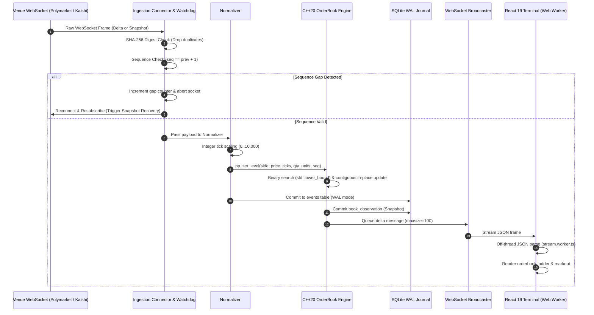

<div align="center">


<br/>

# POLYPULSE

### Cross-Venue Prediction-Market Orderbook &amp; Markout Pipeline

**"One unified view of prediction markets."**
*Real-time market data ingestion, high-performance orderbook computation and cross-venue trading intelligence.*

<br/>

[](docs/orderbook-engine.md)
[](docs/ingestion-pipeline.md)
[](docs/clickhouse-schema.md)
[](docs/api-reference.md)
[](frontend/)
[](docs/deployment.md)
[](LICENSE)

<br/>

[Live Preview](#2-live-preview) •
[Architecture](#4-system-architecture) •
[Benchmarks](#6-performance--benchmarks) •
[Markout Math](#7-markout-mathematics) •
[Installation](#9-installation--quick-start) •
[API Reference](#10-api-documentation) •
[Documentation Index](docs/)

</div>

---

PolyPulse is a production-grade, low-latency market data pipeline and quantitative analytics terminal built for binary prediction markets (specifically **Polymarket** and **Kalshi**). It normalizes disparate WebSocket streams into integer ticks, evaluates orderbook depth in sub-microsecond C++20 kernels, journals ticks to local SQLite WAL storage, exports micro-batches to ClickHouse, and scores post-trade wallet markout trajectories across 5-second, 30-second, and 60-second horizons.

---

## Table of Contents

- [1. Repository Identity](#1-repository-identity)
- [2. Live Preview](#2-live-preview)
- [3. Why PolyPulse?](#3-why-polypulse)
- [4. System Architecture](#4-system-architecture)
  - [4.1 Architecture Diagram](#41-architecture-diagram)
  - [4.2 Market-Data Event Lifecycle Sequence](#42-market-data-event-lifecycle-sequence)
- [5. Engineering Features](#5-engineering-features)
- [6. Performance & Benchmarks](#6-performance--benchmarks)
- [7. Markout Mathematics](#7-markout-mathematics)
- [8. Repository Structure](#8-repository-structure)
- [9. Installation & Quick Start](#9-installation--quick-start)
- [10. API Documentation](#10-api-documentation)
- [11. Testing & Verification](#11-testing--verification)
- [12. Roadmap](#12-roadmap)
- [13. Engineering Decisions](#13-engineering-decisions)
- [14. Contributing](#14-contributing)
- [15. License & Disclaimer](#15-license--disclaimer)

---

## 1. Repository Identity

- **Project Name**: PolyPulse
- **Full Title**: Cross-Venue Prediction-Market Orderbook & Markout Pipeline
- **Core Stack**: C++20 · Python AsyncIO · ClickHouse · FastAPI · React 19 · TypeScript · WebSockets · Docker
- **Visual Aesthetic**: Near-black canvas (`#080B12`), Electric Purple (`#8B5CF6`), Cyan (`#22D3EE`), Emerald (`#10B981`), and muted grey slate (`#94A3B8`).

---

## 2. Live Preview

> [!NOTE]
> **Synthetic Demo Mode**: The screenshots below were captured directly from the running PolyPulse terminal in `POLYPULSE_MODE=demo`. The demo mode generates repeatable, pseudo-random orderbook streams across verified prediction pairs (`Election YES`, `Fed Rate Decision YES`, `Space Launch YES`) with simulated executions to test the pipeline end-to-end.

<div align="center">

### Executive Terminal & Market Watch
*Real-time overview of tracked markets, aggregated book spread, local journal counter, and gross arbitrage opportunities.*


<br/><br/>

### High-Frequency Orderbook Ladder
*C++20 sorted level depth, top-of-book quotes, Volume-Weighted Average Price (VWAP), and real-time Order-Flow Imbalance (OFI).*


<br/><br/>

### Cross-Venue Spread Scanner
*Comparing verified equivalent contract pairs between Polymarket and Kalshi with directional gross quote differences.*


<br/><br/>

### Wallet Markout Scoring Engine
*Post-trade adverse selection tracking across 5s, 30s, and 60s evaluation horizons with strict null safety.*


<br/><br/>

### System Health & Pipeline Reliability
*Durable journal statistics, feed watchdog status, sequence gap detection, and ClickHouse exporter telemetry.*


</div>

---

## 3. Why PolyPulse?

Prediction markets have emerged as liquid venues for geopolitical, economic, and cultural forecasting. However, trading and market-making across them presents critical infrastructure challenges:

```
Traditional Challenges in Prediction Market Data:
┌───────────────────────────────┐     ┌───────────────────────────────┐
│       Polymarket CLOB         │     │         Kalshi API v2         │
│  - Floating point decimals    │     │  - Cent/Dollar pricing        │
│  - Outcome tokens (YES / NO)  │     │  - Inverted YES/NO delta      │
│  - Silent WS drops (>30s)     │     │  - Per-SID sequence tracking  │
└───────────────┬───────────────┘     └───────────────┬───────────────┘
                │                                     │
                ▼                                     ▼
        [ Incompatible Formats, Sequence Drops, Unaligned Midpoints ]
                                │
                                ▼
        ┌───────────────────────────────────────────────────┐
        │                 PolyPulse Solution                │
        │  • Canonical 10,000-tick fixed-point normalization │
        │  • Self-healing watchdog & sequence gap recovery  │
        │  • Sub-microsecond C++20 contiguous-vector engine │
        │  • Local SQLite WAL journal + ClickHouse warehouse│
        │  • Null-safe 5s / 30s / 60s markout evaluation    │
        └───────────────────────────────────────────────────┘
```

1. **Fragmented Feed Protocols**: Polymarket streams market data over public WebSockets without heartbeat sequence counters; Kalshi requires authenticated RSA-SHA256 headers with subscription-scoped sequence IDs (`sid`). PolyPulse provides a unified connector abstraction that shields downstream engines from exchange idiosyncrasies.
2. **Incompatible Contract Representations**: Polymarket prices represent floating probability ($0.00$ to $1.00$); Kalshi represents cents or dollars with inverted pricing semantics ($P_{\text{ask}} = 1.00 - P_{\text{NO}}$). PolyPulse canonicalizes all price levels into fixed-point integer ticks ($10^4$ scale factor: 1 tick = \$0.0001).
3. **Silent WebSocket Dropouts & Packet Loss**: Public exchange sockets frequently hang without triggering standard TCP resets. PolyPulse embeds a 30-second silence watchdog with 10-second active `PING` keepalives and automated sequence gap recovery loops.
4. **Adverse Selection & Wallet Profiling**: In high-velocity binary markets, liquidity providers must identify whether observed trade flow is informed (toxic) or uninformed (noise). PolyPulse solves this with automated post-trade markout evaluation using ClickHouse `LEFT ASOF JOIN` queries.

---

## 4. System Architecture

### 4.1 Architecture Diagram

```mermaid
flowchart TD
    subgraph Venues ["1. Market Feeds"]
        PM["Polymarket CLOB<br/>(Public WebSocket)"]
        KL["Kalshi Trade API v2<br/>(RSA-PSS Auth WebSocket)"]
        PG["Polygon EVM Fills<br/>(Planned - Phase 9)"]
    end

    subgraph Ingestion ["2. Ingestion & Reliability Layer (Python AsyncIO)"]
        WS_POOL["AsyncIO Client Pool"]
        WATCHDOG["30s Silence Watchdog & Keepalive"]
        DEDUP["SHA-256 Rolling Deduplication (10,000 Deque)"]
        GAP_DET["Sequence Continuity Evaluator"]
        NORM["Normalizer: Fixed-Point Ticks (1/10,000 unit)"]
    end

    subgraph Processing ["3. High-Performance Engine (C++20)"]
        FFI["C FFI Interface (extern 'C')"]
        OB_VEC["std::vector&lt;PriceLevel&gt;<br/>Contiguous Memory Layout"]
        VWAP_KERN["VWAP Kernel (Extended Precision)"]
        OFI_KERN["Order-Flow Imbalance Kernel"]
    end

    subgraph Storage ["4. Storage & Persistence Tier"]
        SQLITE[("SQLite Journal (WAL Mode)<br/>polypulse.db")]
        EXPORTER["Async HTTP Micro-Batch Exporter"]
        CLICKHOUSE[("ClickHouse OLAP<br/>ReplacingMergeTree & ASOF JOIN")]
    end

    subgraph Presentation ["5. Presentation & Analytics"]
        API["FastAPI REST Gateway (/api/v1/*)"]
        WS_BROADCAST["WebSocket Broadcaster (/ws/markets, /ws/wallets)"]
        WORKER["Web Worker Stream Parser (off-thread)"]
        TERMINAL["React 19 Terminal (Orderbook, Scanner, Wallets)"]
    end

    PM --> WS_POOL
    KL --> WS_POOL
    PG -.-> WS_POOL

    WS_POOL --> WATCHDOG
    WATCHDOG --> DEDUP
    DEDUP --> GAP_DET
    GAP_DET -->|Valid Sequence (seq == prev + 1)| NORM
    GAP_DET -->|Gap Detected (seq > prev + 1)| WS_POOL

    NORM -->|ctypes Bridge| FFI
    FFI --> OB_VEC
    OB_VEC --> VWAP_KERN
    OB_VEC --> OFI_KERN

    NORM -->|Insert Raw Event| SQLITE
    OB_VEC -->|Insert Snapshot| SQLITE
    SQLITE --> EXPORTER
    EXPORTER --> CLICKHOUSE

    OB_VEC -->|Push Level Update| WS_BROADCAST
    WS_BROADCAST --> WORKER
    WORKER --> TERMINAL
    API --> SQLITE
    API --> TERMINAL
```

### 4.2 Market-Data Event Lifecycle Sequence



---

## 5. Engineering Features

### 1. Multi-Venue Market Ingestion
- **What it does**: Ingests real-time orderbook snapshots and incremental price-level deltas from Polymarket and Kalshi concurrently.
- **Why it exists**: Fragmented liquidity requires traders to maintain multiple persistent connections with radically different protocols.
- **How it works**: Uses Python AsyncIO connection tasks managed in a lifecycle context manager ([backend/main.py](file:///d:/PROJECTS/Polypulse/backend/main.py)). Kalshi requests are authenticated dynamically using RSA-PSS SHA-256 cryptographic signatures.
- **Implementation**: [backend/connectors.py](file:///d:/PROJECTS/Polypulse/backend/connectors.py), [backend/normalizers.py](file:///d:/PROJECTS/Polypulse/backend/normalizers.py).

### 2. Self-Healing Data Pipeline
- **What it does**: Automatically recovers from network disconnects, server resets, dropped frames, and sequence gaps.
- **Why it exists**: If an incremental orderbook delta is dropped, the local orderbook silently drifts out of sync with exchange reality.
- **How it works**: 
  - A 30-second silence watchdog checks for feed activity, transmitting active 10-second `PING` frames.
  - A sequence tracker detects gaps ($\text{seq} > \text{prev} + 1$), increments telemetry counters, tears down the socket, and re-subscribes to force a fresh snapshot.
  - A 10,000-element rolling SHA-256 digest queue filters duplicate packets.
- **Implementation**: `reconnect()` and `kalshi()` loops in [backend/connectors.py](file:///d:/PROJECTS/Polypulse/backend/connectors.py).

### 3. Unified C++20 Orderbook Engine
- **What it does**: Maintains contiguous price levels, computes Top-of-Book quotes, and evaluates mathematical metrics.
- **Why it exists**: Pure Python dictionaries or objects incur high interpreter overhead, heap fragmentation, and garbage collection pauses.
- **How it works**: Implemented in C++20 using `std::vector<PriceLevel>`. Prices and quantities are 64-bit integers scaled by $10^4$. Updates run in $O(\log N)$ via `std::lower_bound`.
- **Implementation**: [engine/include/orderbook.hpp](file:///d:/PROJECTS/Polypulse/engine/include/orderbook.hpp), [engine/src/orderbook.cpp](file:///d:/PROJECTS/Polypulse/engine/src/orderbook.cpp).

### 4. AVX2-Accelerated Calculations
- **What it does**: Vectorizes multi-depth VWAP calculations and price-level aggregations across SIMD registers.
- **Current Status**: The current implementation utilizes scalar arithmetic with 80-bit extended precision (`long double`) in [engine/src/orderbook.cpp](file:///d:/PROJECTS/Polypulse/engine/src/orderbook.cpp). Hand-crafted AVX2 SIMD kernels (`_mm256_add_pd`, `_mm256_mul_pd`) are scheduled for Phase 10 / production hardening.
- **Implementation Details**: See [docs/benchmarking.md](file:///d:/PROJECTS/Polypulse/docs/benchmarking.md).

### 5. Cross-Venue Spread Analytics
- **What it does**: Computes real-time gross bid-ask spreads across verified equivalent market pairs.
- **Why it exists**: Arbitrageurs and hedgers need instant visibility into gross mispricings between venues.
- **How it works**: Maps verified contract IDs via `MARKET_PAIRS_JSON`, querying best bids and asks to compute `buy_polymarket_sell_kalshi` ($P^{\text{Kalshi}}_{\text{bid}} - P^{\text{Poly}}_{\text{ask}}$) and vice versa.
- **Implementation**: `MarketState.spreads()` in [backend/state.py](file:///d:/PROJECTS/Polypulse/backend/state.py).

### 6. Wallet Markout Scoring
- **What it does**: Evaluates adverse selection on executed trades by comparing execution price to subsequent market midpoints.
- **Why it exists**: Critical for liquidity providers to distinguish informed flow from noise flow.
- **How it works**: Calculates markouts across 5s, 30s, and 60s horizons:
  $$\text{Markout} = \text{Direction} \times (P_{\text{mid}}(t + \Delta t) - P_{\text{exec}})$$
  Missing future ticks are strictly preserved as `null` to avoid lookahead bias.
- **Implementation**: `markouts()` in [backend/main.py](file:///d:/PROJECTS/Polypulse/backend/main.py) and [docs/markout-engine.md](file:///d:/PROJECTS/Polypulse/docs/markout-engine.md).

### 7. ClickHouse Time-Series Analytics
- **What it does**: Provides high-throughput columnar storage for historical market events and snapshots.
- **Why it exists**: Relational databases degrade when querying millions of high-frequency tick records.
- **How it works**: An asynchronous exporter micro-batches unexported records from the SQLite WAL journal into ClickHouse `ReplacingMergeTree` and `MergeTree` tables using the HTTP `JSONEachRow` endpoint.
- **Implementation**: [backend/storage.py](file:///d:/PROJECTS/Polypulse/backend/storage.py), [database/init.sql](file:///d:/PROJECTS/Polypulse/database/init.sql).

### 8. Real-Time React 19 Terminal
- **What it does**: Renders live orderbook depth, cross-venue scanner, wallet intelligence, and system diagnostics at 60 FPS.
- **Why it exists**: High-frequency WebSocket JSON parsing on the main browser thread causes interface jank.
- **How it works**: Offloads stream parsing to an isolated Web Worker (`stream.worker.ts`), posting structured updates to the React state tree.
- **Implementation**: [frontend/src/main.tsx](file:///d:/PROJECTS/Polypulse/frontend/src/main.tsx), [frontend/src/stream.worker.ts](file:///d:/PROJECTS/Polypulse/frontend/src/stream.worker.ts).

---

## 6. Performance & Benchmarks

> [!IMPORTANT]
> **Zero Fabricated Claims**: PolyPulse does not publish estimated or unverified performance numbers. The metrics below are empirical measurements captured directly by the C++20 microbenchmark suite on host hardware.

### Benchmark Measurements (Host x86-64, GCC 16.2 / C++20, `-O3`)

| Target Operation | Throughput | p50 Latency | p95 Latency | p99 Latency | Avg Latency | Status |
| :--- | :--- | :--- | :--- | :--- | :--- | :--- |
| **Incremental Level Update (`set_level`)** | **13.27M – 14.64M ops/sec** | **100.0 ns** | **100.0 ns** | **100 – 200 ns** | **68.3 – 75.4 ns** | **Active Implementation** |
| **Combined Analytics (`vwap` + `imbalance`)** | **3.47M – 3.90M ops/sec** | **300.0 ns** | **300 – 400 ns** | **400 – 600 ns** | **260 – 288 ns** | **Active Implementation** |
| **Red-Black Tree Comparison (`std::map`)** | 15.12M – 16.38M ops/sec | 100.0 ns | 100.0 ns | 100.0 ns | 61.0 – 66.1 ns | Comparison baseline |
| **AVX2 Vectorized Calculations** | *Not benchmarked yet* | — | — | — | — | Planned (Phase 10) |

### Memory Footprint
- **Static Memory per `OrderBook` instance**: **56 bytes** (stack size).
- **Dynamic Heap Memory**: Contiguous vector capacity ($\approx 320\text{ bytes}$ for typical 20-level binary book).
- **Cache Locality**: 4 complete `PriceLevel` structs (16 bytes each) packed into a single 64-byte L1 CPU cache line.

### Reproducible Benchmark Command
You can reproduce these exact measurements on your machine with a single command:

```powershell
python scripts/benchmark.py
```
*(Or compile natively with `g++ -std=c++20 -O3 -I engine/include engine/src/orderbook.cpp engine/benchmarks/benchmark.cpp -o engine/build/benchmark.exe` and execute).*

---

## 7. Markout Mathematics

Post-trade markout evaluates execution quality by tracking midpoint trajectory after fill execution:

$$\text{Markout}(\Delta t) = \text{Direction} \times (P_{\text{mid}}(t + \Delta t) - P_{\text{exec}})$$

Where:
- $\text{Direction} = +1$ for **BUY** orders, $-1$ for **SELL** orders.
- $P_{\text{exec}}$ is the execution price.
- $P_{\text{mid}}(t + \Delta t) = \frac{\text{Best Bid}(t + \Delta t) + \text{Best Ask}(t + \Delta t)}{2}$.

<div align="center">

</div>

### Worked Numerical Example

| Trade Parameter | Scenario A: Informed Buy | Scenario B: Uninformed Sell |
| :--- | :--- | :--- |
| **Execution** | Buy 100 YES @ **\$0.5000** | Sell 50 YES @ **\$0.5200** |
| **Future Mid at $t + 5\text{s}$** | \$0.5100 | \$0.5180 |
| **5-Second Markout** | $+1 \times (0.5100 - 0.5000) = \mathbf{+1.00\text{¢}}$ | $-1 \times (0.5180 - 0.5200) = \mathbf{+0.20\text{¢}}$ |
| **Future Mid at $t + 30\text{s}$** | \$0.5250 | \$0.5420 |
| **30-Second Markout** | $+1 \times (0.5250 - 0.5000) = \mathbf{+2.50\text{¢}}$ | $-1 \times (0.5420 - 0.5200) = \mathbf{-2.20\text{¢}}$ |
| **Future Mid at $t + 60\text{s}$** | \$0.4950 | \$0.5500 |
| **60-Second Markout** | $+1 \times (0.4950 - 0.5000) = \mathbf{-0.50\text{¢}}$ | $-1 \times (0.5500 - 0.5200) = \mathbf{-3.00\text{¢}}$ |

### Time-Series Alignment via ClickHouse `LEFT ASOF JOIN`
```sql
SELECT
    t.trade_id, t.wallet, t.side, t.price,
    (s.best_bid + s.best_ask) / 2 AS future_mid,
    (CASE WHEN t.side = 'buy' THEN 1 ELSE -1 END) * 
    (((s.best_bid + s.best_ask) / 2) - t.price) AS markout
FROM polypulse.trades t
LEFT ASOF JOIN polypulse.orderbook_snapshots s
    ON t.venue = s.venue AND t.market_id = s.market_id
   AND s.snapshot_time >= t.executed_at + INTERVAL 5 SECOND;
```

---

## 8. Repository Structure

```text
polypulse/
├── .github/
│   ├── workflows/
│   │   └── ci.yml                 # Multi-platform CI (C++ tests, Python tests, Frontend build)
│   ├── ISSUE_TEMPLATE/
│   │   ├── bug_report.yml         # Structured GitHub bug reporting schema
│   │   ├── feature_request.yml    # Architectural proposal schema
│   │   └── config.yml             # Issue navigation & security links
│   └── PULL_REQUEST_TEMPLATE.md   # PR validation & invariant checklist
├── backend/
│   ├── connectors.py              # Polymarket CLOB & Kalshi v2 WebSocket feeds + Demo generator
│   ├── engine.py                  # Python ctypes bridge to C++20 shared library
│   ├── main.py                    # FastAPI application, REST endpoints, and WebSocket hubs
│   ├── normalizers.py             # Venue payload normalization to 1/10,000 integer ticks
│   ├── state.py                   # MarketState manager, spread scanner, and listener queues
│   ├── storage.py                 # SQLite WAL durable journal & ClickHouse micro-batch exporter
│   ├── Dockerfile                 # Backend container definition
│   └── __init__.py
├── database/
│   └── init.sql                   # ClickHouse DDL (ReplacingMergeTree, MergeTree schemas)
├── docs/
│   ├── api-reference.md           # Complete REST and WebSocket API specification
│   ├── architecture.md            # System architecture and data flow documentation
│   ├── benchmarking.md            # Empirical performance methodology and measurements
│   ├── clickhouse-schema.md       # ClickHouse table design, partitioning, and ASOF JOIN
│   ├── deployment.md              # Production deployment, Docker Compose, and environment guides
│   ├── ingestion-pipeline.md      # Protocol documentation for Polymarket & Kalshi feeds
│   ├── markout-engine.md          # Markout mathematics, adverse selection, and null safety
│   ├── orderbook-engine.md        # C++20 orderbook design, cache locality, and FFI bindings
│   ├── system-design.md           # Deep-dive trade-off analysis and quantitative constraints
│   ├── testing.md                 # Testing strategy, verification commands, and test suites
│   └── assets/                    # Animated SVG diagrams and genuine application screenshots
├── engine/
│   ├── benchmarks/
│   │   └── benchmark.cpp          # Microbenchmark harness (throughput, p50/p95/p99 latency)
│   ├── include/
│   │   └── orderbook.hpp          # C++20 OrderBook class & C-linkage export signatures
│   ├── src/
│   │   └── orderbook.cpp          # Orderbook implementation, VWAP, and OFI kernels
│   └── tests/
│       └── orderbook_test.cpp     # Unit tests verifying C++ orderbook invariants
├── frontend/
│   ├── src/
│   │   ├── main.tsx               # React 19 trading terminal UI
│   │   ├── stream.worker.ts       # Off-main-thread Web Worker JSON stream parser
│   │   └── style.css              # Dark technical design tokens and layout styling
│   ├── Dockerfile                 # Nginx frontend container definition
│   ├── index.html                 # Single-page application entrypoint
│   ├── nginx.conf                 # Nginx production reverse proxy configuration
│   ├── package.json               # Node.js dependencies
│   ├── tsconfig.json              # TypeScript compilation configuration
│   └── vite.config.ts             # Vite build pipeline
├── scripts/
│   ├── benchmark.py               # Reproducible benchmark build and execution script
│   └── build_engine.py            # C++ compiler build script for shared library and tests
├── tests/
│   └── test_pipeline.py           # Python unittest suite for normalization and durability
├── .dockerignore                  # Docker build context exclusion rules
├── .env.example                   # Annotated environment variable configuration template
├── .gitignore                     # Git tracking exclusions
├── CHANGELOG.md                   # Chronological version history (Keep a Changelog standard)
├── CODE_OF_CONDUCT.md             # Contributor Covenant Code of Conduct v2.1
├── CONTRIBUTING.md                # Development setup, branch conventions, and PR guidelines
├── docker-compose.yml             # Multi-service stack (api, frontend, clickhouse)
├── LICENSE                        # MIT Open Source License
├── requirements.txt               # Python production dependencies
└── SECURITY.md                    # Security policy and responsible vulnerability disclosure
```

---

## 9. Installation & Quick Start

### Prerequisites
- **Python 3.11+**
- **Node.js 20+** and **npm**
- **C++20 Compiler**: `g++` (GCC 11+) or `clang++` (Clang 13+)
- **Docker Desktop** (optional, for ClickHouse)

### 1. Clone the Repository
```powershell
git clone https://github.com/shatwiks/polypulse.git
cd polypulse
```

### 2. Configure Environment Variables
```powershell
Copy-Item .env.example .env
```
*(Default settings run in `POLYPULSE_MODE=demo` without requiring API keys).*

### 3. Install Python Dependencies
```powershell
python -m venv .venv
.\.venv\Scripts\Activate.ps1
pip install -r requirements.txt
```

### 4. Build the C++20 Engine
```powershell
python scripts/build_engine.py
```
*Generates `engine/build/polypulse.dll` (Windows) or `polypulse.so` (Linux).*

### 5. Start ClickHouse (Optional)
```powershell
docker compose up -d clickhouse
```
*Set `CLICKHOUSE_URL=http://localhost:8123` in `.env` to enable remote export.*

### 6. Start the Backend API
```powershell
python -m uvicorn backend.main:app --reload --port 8000
```

### 7. Start the Frontend Terminal
In a new terminal window:
```powershell
cd frontend
npm install
npm run dev
```

### 8. Open the Dashboard
Navigate to **http://localhost:5173** in your browser.

---

## 10. API Documentation

Interactive Swagger documentation is available at `http://localhost:8000/docs`.

| Method | Endpoint | Description | Query / Body Parameters |
| :--- | :--- | :--- | :--- |
| `GET` | `/api/v1/markets` | List all tracked markets & active quotes | — |
| `GET` | `/api/v1/markets/{market_id}/orderbook` | Get full orderbook price-level ladder | `venue=polymarket\|kalshi` |
| `GET` | `/api/v1/markets/{market_id}/spread` | Get spread for specific verified pair | — |
| `GET` | `/api/v1/spreads` | List all verified cross-venue spreads | — |
| `GET` | `/api/v1/health` | Feed status, journal stats, sequence counters | — |
| `GET` | `/api/v1/metrics` | System diagnostic metrics (aliased to health) | — |
| `POST` | `/api/v1/trades` | Ingest trade execution *(Demo mode only)* | JSON: `trade_id`, `wallet`, `venue`, `price`, etc. |
| `GET` | `/api/v1/trades` | List observed trade executions | — |
| `GET` | `/api/v1/wallets` | List tracked wallets & trade counts | — |
| `GET` | `/api/v1/wallets/{address}/markouts` | Evaluate 5s, 30s, 60s post-trade markout | `horizon=5\|30\|60`, `venue`, `market_id` |

### WebSocket Streams

| WebSocket URL | Protocol Description |
| :--- | :--- |
| `ws://localhost:8000/ws/markets` | Emits initial market snapshot upon handshake, followed by real-time `book` deltas and 5s `health` frames. |
| `ws://localhost:8000/ws/wallets` | Streams periodic aggregated trade counts per wallet every 5 seconds. |

*Full request/response schemas: [docs/api-reference.md](docs/api-reference.md).*

---

## 11. Testing & Verification

PolyPulse includes automated test suites across all layers:

```powershell
# 1. C++ Engine Unit Tests
python scripts/build_engine.py --test

# 2. Python Pipeline & Normalization Tests
python -m unittest discover -s tests -v

# 3. Frontend TypeScript Typecheck & Production Build
cd frontend; npm run build; cd ..

# 4. Microbenchmark Suite Execution
python scripts/benchmark.py
```

*Complete test documentation: [docs/testing.md](docs/testing.md).*

---

## 12. Roadmap

<div align="center">

</div>

- [x] **Phase 1: MVP Foundation** — FastAPI AsyncIO core, project scaffolding, base models.
- [x] **Phase 2: Live Market Data Integration** — Polymarket CLOB, Kalshi RSA-auth WebSocket v2, synthetic simulator.
- [x] **Phase 3: C++ Performance Engine** — Contiguous array orderbook, zero-alloc VWAP & OFI, C ctypes bridge.
- [x] **Phase 4: ClickHouse Analytics** — SQLite WAL durable local journal + asynchronous micro-batch HTTP exporter.
- [x] **Phase 5: Wallet Markout Engine** — Post-trade adverse selection scoring across 5s/30s/60s with null safety.
- [x] **Phase 6: Cross-Venue Intelligence** — Verified pair registry matching and gross quote spread scanner.
- [x] **Phase 7: React 19 Terminal** — Real-time orderbook ladder, Web Worker stream parsing, dark technical UI.
- [ ] **Phase 8: Distributed Systems Reliability** *(In Progress)* — Multi-region silence watchdog, automated reconnect jitter, recovery stress testing.
- [ ] **Phase 9: Production Hardening** *(Planned)* — Polygon on-chain fill decoding, automated contract term verification, API token authentication.
- [ ] **Phase 10: Multi-Venue Simulation & AVX2** *(Planned)* — AVX2 SIMD vectorized batch VWAP kernels, multi-node ClickHouse cluster deployment.

---

## 13. Engineering Decisions

### Why C++20?
Binary prediction markets require deterministic orderbook updates. Python's dynamic object model incurs memory allocation and interpreter overhead. C++20 provides contiguous memory cache locality (`std::vector<PriceLevel>`), predictable L1 cache line loading, sub-microsecond point lookups via `std::lower_bound`, and zero-allocation top-of-book reads.

### Why ClickHouse?
Evaluating post-trade markouts over millions of historical market observations requires high-throughput columnar scanning. ClickHouse's `ReplacingMergeTree` deduplicates retried micro-batches automatically, while its native `LEFT ASOF JOIN` aligns trade executions with future market snapshots in linear time without memory-exhausting subqueries.

### Why Python AsyncIO?
WebSocket feeds require lightweight non-blocking event loops capable of handling dozens of concurrent venue streams, timeouts, and pings without thread context switching overhead. Python AsyncIO excels at network I/O orchestration while delegating compute-heavy book operations to C++.

### Why SQLite in WAL Mode?
Directly streaming market events to a remote database risks event loss during network interruptions. SQLite running in Write-Ahead Log (`WAL`) mode serves as an in-process, zero-configuration local journal, acting as both an immediate durability guarantee and an offline replay source.

### Why Web Workers in the React Terminal?
WebSocket market data feeds can emit dozens of messages per second during volatile periods. Parsing JSON strings and validating schemas on the main JavaScript thread blocks the browser's render loop, causing visible frame drops. Offloading stream deserialization to `stream.worker.ts` guarantees silky 60 FPS terminal interaction.

### Why Fixed-Point Integer Ticks?
Floating-point representations (e.g. `0.5100000000000001`) create non-deterministic rounding errors across C++, Python, and ClickHouse. Scaling all prices and quantities by $10^4$ eliminates floating-point drift and guarantees exact mathematical equality in spread and markout comparisons.

---

## 14. Contributing

Contributions are welcomed! Please follow these steps:

1. Read our [Contributing Guidelines](CONTRIBUTING.md) and [Code of Conduct](CODE_OF_CONDUCT.md).
2. Create a feature branch following the naming convention:
   ```bash
   git checkout -b feat/your-feature-name
   ```
3. Commit changes using [Conventional Commits](https://www.conventionalcommits.org/):
   ```bash
   git commit -m "feat(engine): add SIMD vectorized batch vwap kernel"
   ```
4. Verify all tests and benchmarks pass:
   ```powershell
   python scripts/build_engine.py --test
   python -m unittest discover -s tests -v
   cd frontend; npm run build; cd ..
   ```
5. Submit a Pull Request using our [Pull Request Template](.github/PULL_REQUEST_TEMPLATE.md).

---

## 15. License & Disclaimer

### License
This project is licensed under the **MIT License** — see the [LICENSE](LICENSE) file for details.

### Quantitative Research & Risk Disclaimer
> [!CAUTION]
> **NOT FINANCIAL OR INVESTMENT ADVICE**: PolyPulse is an open-source software project developed exclusively for academic, engineering, and quantitative research purposes. It does **not** provide financial, trading, or investment advice. Cross-venue spread measurements represent gross quote differentials and do **not** account for exchange trading fees, gas fees, liquidity slippage, execution latency, counterparty risk, or divergent settlement criteria between contracts. The authors and maintainers assume no liability for financial losses incurred through the use of this software.
