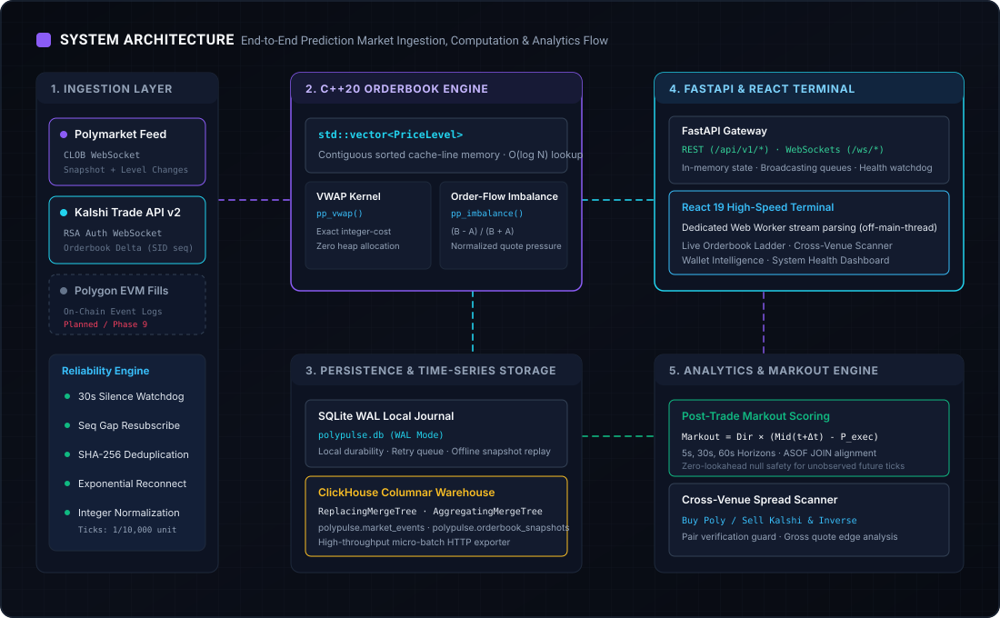
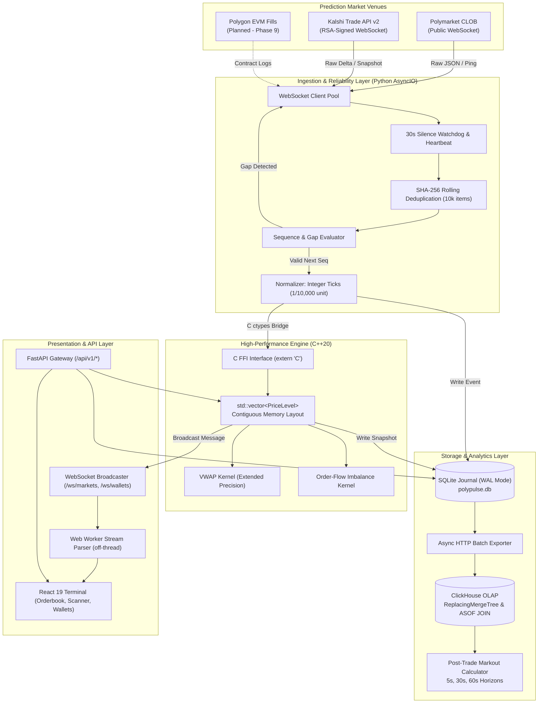
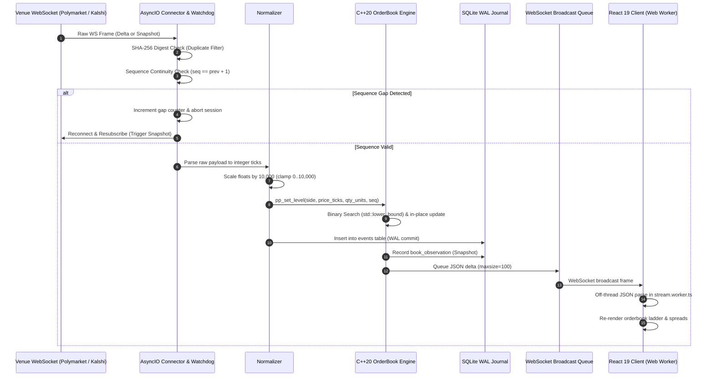

# System Architecture

PolyPulse is a high-performance cross-venue market data ingestion, normalization, and markout pipeline designed for prediction markets (such as Polymarket and Kalshi). It provides a unified orderbook interface, deterministic tick-level event processing, local SQLite journaling, scalable ClickHouse time-series persistence, and a real-time reactive trading terminal.

---

## 1. High-Level Architecture Overview

PolyPulse is split into four decoupled architectural tiers:
1. **Ingestion & Self-Healing Pipeline (Python AsyncIO)**: Ingests raw public and authenticated WebSocket streams, enforces sequence integrity, detects gaps, deduplicates payloads, and normalizes disparate venue schemas into integer ticks.
2. **Core Computational Engine (C++20)**: Maintains contiguous sorted orderbook levels, computes Top-of-Book quotes, calculates zero-allocation Volume-Weighted Average Price (VWAP), and evaluates Order-Flow Imbalance (OFI).
3. **Storage & Analytics Tier (SQLite WAL & ClickHouse)**: Guarantees local durability and offline replay via SQLite in Write-Ahead Log (WAL) mode, and asynchronously micro-batches events to a ClickHouse columnar warehouse for post-trade markout scoring.
4. **Presentation & Terminal Layer (FastAPI & React 19)**: Streams live book updates and metrics via WebSockets to a React terminal utilizing off-main-thread Web Workers for high-throughput JSON deserialization.

---

## 2. End-to-End Component Interaction

---

## 3. Market-Data Event Lifecycle

The lifecycle of an orderbook delta or snapshot follows strict sequence and state invariants to prevent race conditions and state corruption.

---

## 4. Key Architectural Decisions

### Contiguous Flat Vector vs. Pointer Trees
Typical financial engines use red-black trees (`std::map`) or skip lists for orderbooks. In prediction markets, binary contracts have bounded price levels (0.00 to 1.00 dollars, represented as 0 to 10,000 integer ticks). Most active prediction market contracts have fewer than 20 distinct active price levels.
- A contiguous `std::vector<PriceLevel>` guarantees cache-line locality: four 16-byte `PriceLevel` structs fit inside a single 64-byte L1 cache line.
- `std::lower_bound` executes in under 70 ns with virtually zero cache misses and zero dynamic heap allocation during normal quote movements.

### Zero-Copy / Extended Precision Arithmetic
- Arithmetic in `vwap()` uses 80-bit extended precision (`long double`) to prevent integer overflow when multiplying large contract quantities by tick prices, while avoiding intermediate dynamic floating-point allocations.
- Fixed-point integer ticks eliminate floating-point non-determinism and representation errors across Python, C++, and ClickHouse.

### Local Write-Ahead Log (WAL) Before Remote Warehouse
- Remote warehouse connectivity (e.g., ClickHouse) can experience network latency or transient network partitions.
- By committing all events synchronously to a local SQLite database in WAL mode before asynchronous export, the application retains zero event loss and can replay state deterministically upon cold startup.
