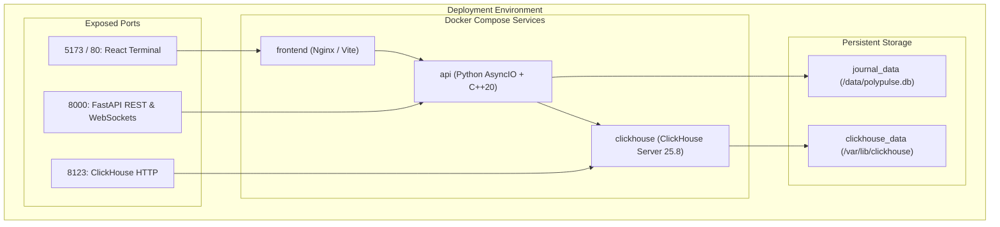

# Deployment & Operations Guide

PolyPulse supports local developer execution, containerized orchestration via Docker Compose, and production deployment patterns.

---

## 1. Deployment Topologies



---

## 2. Docker Compose Deployment (Recommended)

The easiest way to run the full stack with all three services is using Docker Compose:

```powershell
docker compose up --build -d
```

### Services Initialized:
1. **`clickhouse`**: Starts ClickHouse Server 25.8, loads schema from `database/init.sql`, and runs a healthcheck query (`SELECT 1`).
2. **`api`**: Waits for ClickHouse to be healthy, builds the C++20 engine, and starts Uvicorn on port 8000.
3. **`frontend`**: Builds the static React 19 bundle and serves it via Nginx on port 5173 (or 80).

To view live logs:
```powershell
docker compose logs -f api
```

To stop all containers:
```powershell
docker compose down
```

---

## 3. Local Bare-Metal Developer Setup

### Prerequisites
- **Python 3.11+**
- **Node.js 20+** and **npm**
- **C++20 Compiler**: `g++` (GCC 11+) or `clang++` (Clang 13+)

### Step-by-Step Instructions

1. **Clone the Repository**:
   ```powershell
   git clone https://github.com/shatwiks/polypulse.git
   cd polypulse
   ```

2. **Configure Python Virtual Environment**:
   ```powershell
   python -m venv .venv
   .\.venv\Scripts\Activate.ps1
   pip install -r requirements.txt
   ```

3. **Build the C++20 Orderbook Engine**:
   ```powershell
   python scripts/build_engine.py
   ```
   *Generates `engine/build/polypulse.dll` (Windows) or `polypulse.so` (Linux).*

4. **Start the API Server**:
   ```powershell
   python -m uvicorn backend.main:app --reload --port 8000
   ```

5. **Start the Frontend Development Server** (in a separate terminal):
   ```powershell
   cd frontend
   npm install
   npm run dev
   ```

6. **Open Dashboard**:
   Navigate to `http://localhost:5173` in your browser.

---

## 4. Environment Variables Configuration

Copy `.env.example` to `.env`:

```ini
# Operating Mode: demo (synthetic data) or live (real venue feeds)
POLYPULSE_MODE=demo

# Polymarket Configuration (Comma-separated token IDs)
POLYMARKET_ASSET_IDS=21742633143463906290569050155826241533067272733775364947930777080063429301722

# Kalshi Configuration (Ticker symbols)
KALSHI_MARKET_TICKERS=KXINTRATE-25DEC-T0.25
KALSHI_API_KEY_ID=your-kalshi-access-key-id
KALSHI_PRIVATE_KEY_PATH=/path/to/kalshi-ecdsa-or-rsa-private-key.pem

# Cross-Venue Verified Pairs JSON
MARKET_PAIRS_JSON=[{"name":"Dec 2025 Fed Rate Cut","polymarket":"21742633...","kalshi":"KXINTRATE-25DEC-T0.25"}]

# ClickHouse Connection URL (Optional - leave blank to disable remote export)
CLICKHOUSE_URL=http://localhost:8123

# Local SQLite Journal File Path
POLYPULSE_DB=polypulse.db
```

---

## 5. Security & Operational Hardening

- **Private Key Permissions**: Ensure your Kalshi PEM file permissions are restricted (`chmod 600 key.pem`). Never check private keys or API secrets into version control.
- **Production Mode Safeguards**: When `POLYPULSE_MODE=live`, the manual trade ingestion route (`POST /api/v1/trades`) is automatically disabled with HTTP 403 Forbidden to prevent synthetic state contamination.
- **SQLite WAL Checkpointing**: The SQLite database runs with `PRAGMA journal_mode=WAL`, permitting concurrent non-blocking reads during background micro-batch exports.
