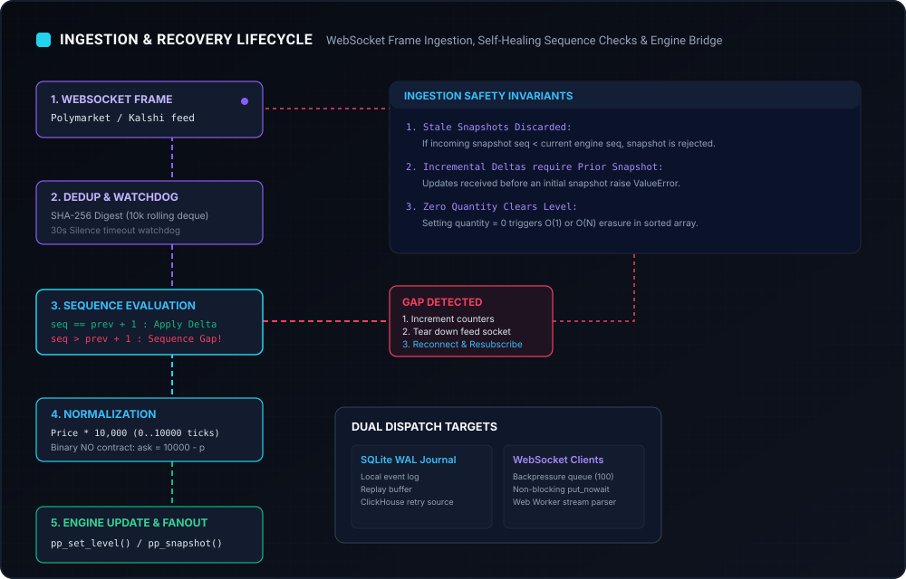

# Ingestion Pipeline & Normalization

The Ingestion Pipeline is responsible for connecting to prediction market WebSocket APIs, handling protocol-level heartbeats, detecting dropped packets, deduplicating messages, and converting heterogeneous venue formats into canonical fixed-point structures.



---

## 1. Supported Venue Feeds

| Venue | Protocol Endpoint | Authentication | Message Format | Sequence Scope |
| :--- | :--- | :--- | :--- | :--- |
| **Polymarket** | `wss://ws-subscriptions-clob.polymarket.com/ws/market` | Public | JSON (`book`, `price_change`) | Per-asset synthetic seq |
| **Kalshi** | `wss://external-api-ws.kalshi.com/trade-api/ws/v2` | RSA-SHA256 Signed Headers | JSON (`orderbook_snapshot`, `orderbook_delta`) | Per-subscription SID seq |
| **Synthetic Demo** | In-process generator (`backend.connectors.demo`) | None | Simulated snapshots and deltas | Global deterministic seq |

---

## 2. Polymarket Ingestion Protocol

### Subscription
Polymarket market data is subscribed using the public CLOB market channel:
```json
{
  "assets_ids": ["0x1234..."],
  "type": "market"
}
```

### Heartbeat & Silence Watchdog
Polymarket does not always send periodic heartbeats if trading is quiet. PolyPulse manages this with a dual-stage watchdog:
1. **Active Keepalive**: Every 10 seconds of silence, PolyPulse sends a raw `"PING"` text frame to the server. The server responds with `"PONG"`.
2. **Silence Watchdog**: If no frame has been received for $>30$ seconds (evaluated across 3 consecutive 10-second receive timeouts), PolyPulse raises a `TimeoutError("Polymarket feed silence")`, forcing a socket tear-down and fresh snapshot request.

### Message Normalization
- **Snapshot (`book`)**: Extracts bid and ask arrays and normalizes price and size using `units(val, price=True)` and `units(val)`.
- **Level Delta (`price_change`)**: Iterates through `price_changes`, maps `"BUY"` to bid and `"SELL"` to ask, and yields single-level delta instructions.

---

## 3. Kalshi Authenticated Ingestion Protocol

### RSA-SHA256 Header Authentication
Kalshi's WebSocket v2 requires cryptographic request signing on connection:
```python
def kalshi_headers(key_id, private_key_path):
    stamp = str(int(time.time() * 1000))
    path = "/trade-api/ws/v2"
    key = serialization.load_pem_private_key(Path(private_key_path).read_bytes(), password=None)
    signature = key.sign(
        (stamp + "GET" + path).encode(),
        padding.PSS(mgf=padding.MGF1(hashes.SHA256()), salt_length=padding.PSS.DIGEST_LENGTH),
        hashes.SHA256()
    )
    return {
        "KALSHI-ACCESS-KEY": key_id,
        "KALSHI-ACCESS-TIMESTAMP": stamp,
        "KALSHI-ACCESS-SIGNATURE": base64.b64encode(signature).decode()
    }
```

### Channel Subscription
Once connected, PolyPulse subscribes to the `orderbook_delta` channel:
```json
{
  "id": 1,
  "cmd": "subscribe",
  "params": {
    "channels": ["orderbook_delta"],
    "market_tickers": ["KXINTRATE-25DEC-T0.25"]
  }
}
```

### Sequence Tracking & Inversion
Kalshi sequence numbers are tracked per subscription SID:
1. **Initial Snapshot**: Contains `yes_dollars_fp` and `no_dollars_fp`. `no` levels are inverted to equivalent `ask` levels:
   $$\text{ask\_price} = 10\,000 - (\text{price} \times 10^4)$$
2. **Deltas**: Kalshi delivers signed changes in quantity (`delta_fp`). PolyPulse maintains current level quantity in an in-memory dictionary `quantities[(market, side, price)]` and applies the delta:
   $$\text{new\_quantity} = \text{current\_quantity} + \text{delta}$$
   If `new_quantity == 0`, the level is deleted from the C++ orderbook.

---

## 4. Deduplication Engine

To guard against upstream retransmissions, PolyPulse maintains a fixed-size rolling deque of SHA-256 payload digests:
```python
digest = hashlib.sha256(raw.encode() if isinstance(raw, str) else raw).digest()
if digest in seen:
    state.counters["duplicates"] += 1
    continue
seen.add(digest)
recent.append(digest)
if len(recent) > 10_000:
    seen.discard(recent.popleft())
```
- Operates in $O(1)$ lookup time using `set` and `deque`.
- Prevents reprocessing duplicate book updates or corrupting level quantities.

---

## 5. Synthetic Demo Feed

When started with `POLYPULSE_MODE=demo` (the default setting), PolyPulse spins up a synthetic feed generating three verified sample prediction market pairs:
1. **Election outcome · YES** (`demo-poly-election` / `demo-kalshi-election`, mid ~0.5000)
2. **Rate decision · YES** (`demo-poly-rates` / `demo-kalshi-rates`, mid ~0.6350)
3. **Space launch · YES** (`demo-poly-space` / `demo-kalshi-space`, mid ~0.7200)

The demo generator uses a seeded PRNG (`random.Random(42)`) to ensure repeatable snapshots, realistic orderbook dynamics, occasional gross spread opportunities, and background simulated trades to feed the wallet markout engine.
