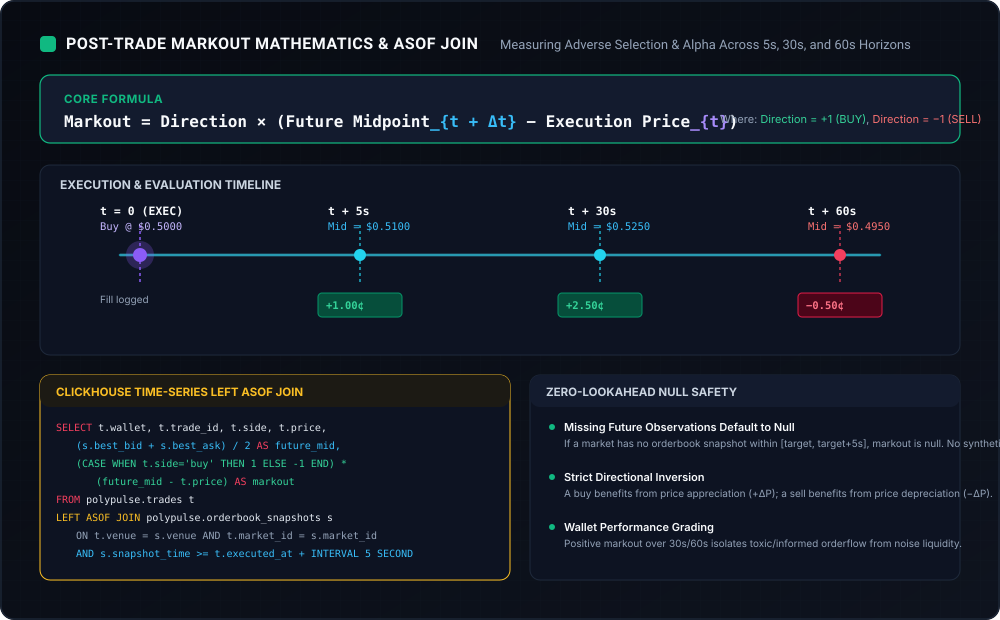

# Wallet Markout Scoring Engine

Post-trade markout scoring is a fundamental quantitative technique used by market makers, liquidity providers, and statistical arbitrageurs to measure **adverse selection**, **execution quality**, and **trader toxicity** (alpha).



---

## 1. What is Markout Analysis?

When a trade executes at time $t$ at price $P_{\text{exec}}$, markout measures how the market midpoint moves in the subsequent seconds ($t + \Delta t$).

$$\text{Markout}(\Delta t) = \text{Direction} \times (P_{\text{mid}}(t + \Delta t) - P_{\text{exec}})$$

Where:
- $\text{Direction} = +1$ for a **BUY** order.
- $\text{Direction} = -1$ for a **SELL** order.
- $P_{\text{mid}}(t) = \frac{\text{Best Bid}(t) + \text{Best Ask}(t)}{2}$.

### Economic Interpretation
- **Positive Markout ($> 0$)**: The trader bought before the price rose, or sold before it fell. The trader exhibited positive alpha (informed flow). If the trade was filled against a market maker, the market maker experienced **adverse selection**.
- **Negative Markout ($< 0$)**: The price moved against the trader immediately after execution. The flow was uninformed or retail noise, representing profitable flow for liquidity providers.

---

## 2. Standard Evaluation Horizons

PolyPulse evaluates markouts across three distinct horizons:

| Horizon ($\Delta t$) | Market Phenomenon Captured |
| :--- | :--- |
| **5 Seconds** | Immediate latency arbitrage, quote fading, and high-frequency toxic order-flow. |
| **30 Seconds** | Medium-term short-term momentum, order shredding, and event-driven news breaks. |
| **60 Seconds** | Sustained price discovery, institutional inventory accumulation, and macro drift. |

---

## 3. Worked Numerical Example

Consider a sequence of fills on an election binary contract:

### Example 1: Buy Order (Informed / Positive Markout)
- **Time $t_0$**: Wallet `0xAlpha` buys 100 YES contracts at execution price $P_{\text{exec}} = 0.5000$.
- **At $t_0 + 5\text{s}$**: Market quotes are Bid $0.5080$ / Ask $0.5120$.
  $$P_{\text{mid}}(5\text{s}) = \frac{0.5080 + 0.5120}{2} = 0.5100$$
  $$\text{Markout}(5\text{s}) = +1 \times (0.5100 - 0.5000) = +0.0100 \ (+1.00\text{¢})$$
- **At $t_0 + 30\text{s}$**: Quotes shift to Bid $0.5240$ / Ask $0.5260$ ($P_{\text{mid}} = 0.5250$).
  $$\text{Markout}(30\text{s}) = +1 \times (0.5250 - 0.5000) = +0.0250 \ (+2.50\text{¢})$$
- **At $t_0 + 60\text{s}$**: Quotes retrace to Bid $0.4940$ / Ask $0.4960$ ($P_{\text{mid}} = 0.4950$).
  $$\text{Markout}(60\text{s}) = +1 \times (0.4950 - 0.5000) = -0.0050 \ (-0.50\text{¢})$$

### Example 2: Sell Order (Uninformed / Negative Markout)
- **Time $t_0$**: Wallet `0xRetail` sells 50 YES contracts at $P_{\text{exec}} = 0.5200$.
- **At $t_0 + 30\text{s}$**: Quotes rise to Bid $0.5400$ / Ask $0.5440$ ($P_{\text{mid}} = 0.5420$).
  $$\text{Markout}(30\text{s}) = -1 \times (0.5420 - 0.5200) = -0.0220 \ (-2.20\text{¢})$$

---

## 4. Handling Missing Observations & Null Safety

In real-world prediction markets, low-liquidity contracts may experience extended periods without level changes.

### The Lookahead Bias Fallacy
Many naive backtesting engines fill in missing future quotes by interpolating between the last known quote and a future quote hours later. **This introduces severe lookahead bias.**

### The PolyPulse Rule
In PolyPulse ([backend/storage.py](file:///d:/PROJECTS/Polypulse/backend/storage.py)), future midpoints are resolved with a tight 5-second tolerance window:
```python
def future_mid(self, venue, market_id, target):
    row = self.db.execute(
        "SELECT payload FROM book_observations "
        "WHERE venue=? AND market_id=? AND recorded_at>=? AND recorded_at<=? "
        "ORDER BY recorded_at LIMIT 1",
        (venue, market_id, target, target + 5)
    ).fetchone()
    if not row:
        return None
    view = json.loads(row[0])
    return (view["best_bid"] + view["best_ask"]) / 2 if view.get("best_bid") is not None and view.get("best_ask") is not None else None
```

- If no orderbook observation exists within $[t + \Delta t, t + \Delta t + 5\text{s}]$, `future_mid` returns `None`.
- The markout endpoint outputs `markout: null` and `available: false`.
- The aggregate summary reports `available_count` alongside `trade_count`, ensuring statistics are mathematically honest and unskewed.
