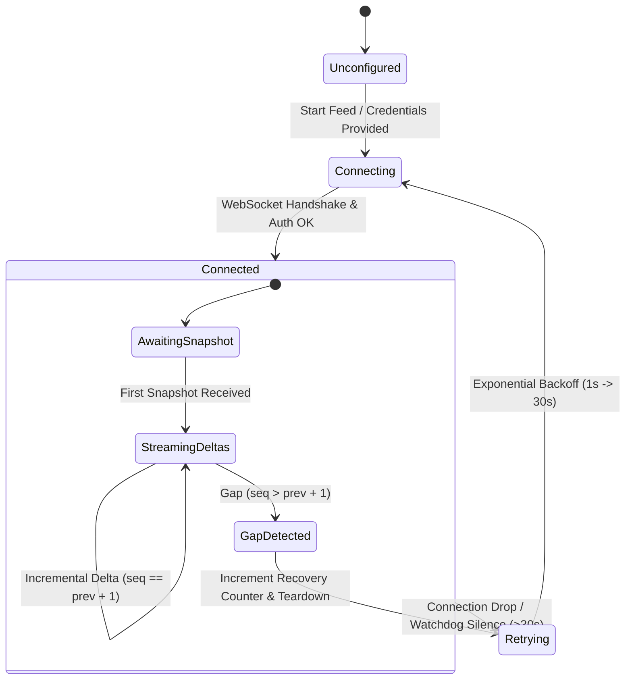

# System Design

This document details the engineering design, architectural trade-offs, and resilience patterns underlying PolyPulse. It is structured for technical reviewers, quantitative infrastructure engineers, and systems developers.

---

## 1. Design Goals & Quantitative Constraints

| Requirement | Target Specification | Engineering Implementation |
| :--- | :--- | :--- |
| **Numeric Determinism** | Exact fixed-point precision across platforms | Scale factor of $10^4$ (1 tick = \$0.0001); all prices $0 \le P \le 10\,000$ |
| **Ingestion Resilience** | Continuous feed uptime despite venue drops | 30s silence watchdog, sequence gap recovery, exponential backoff |
| **Microsecond Engine Latency** | Sub-microsecond level update & quote extraction | C++20 engine with contiguous array cache locality (avg 68–75 ns) |
| **Durable Replayability** | Zero event loss during upstream disconnection | Local SQLite journal in WAL mode as primary journal + retry buffer |
| **High-Throughput Analytics** | Analytical post-trade markout evaluation | ClickHouse columnar storage with `ReplacingMergeTree` & `ASOF JOIN` |
| **UI Responsiveness** | 60 FPS UI updates under heavy market bursts | Off-thread Web Worker JSON deserialization preventing React jank |

---

## 2. Concurrency Architecture

PolyPulse employs an **in-process shared-memory architecture** rather than an inter-process communication (IPC) or microservices mesh:

```
┌─────────────────────────────────────────────────────────────┐
│                    Python AsyncIO Process                   │
│                                                             │
│  ┌──────────────────────┐        ┌──────────────────────┐  │
│  │   AsyncIO Event Loop │        │  SQLite WAL Journal  │  │
│  │  (WebSocket Feeds)   │        │     (In-Process)     │  │
│  └──────────┬───────────┘        └──────────▲───────────┘  │
│             │                               │               │
│             ▼                               │               │
│  ┌──────────────────────────────────────────┴────────────┐  │
│  │                In-Memory State Coordinator            │  │
│  └──────────────────────────┬────────────────────────────┘  │
│                             │                               │
│                      ctypes C FFI                           │
│                             ▼                               │
│  ┌───────────────────────────────────────────────────────┐  │
│  │                C++20 Shared Engine Library            │  │
│  │               (polypulse.dll / polypulse.so)          │  │
│  └───────────────────────────────────────────────────────┘  │
└─────────────────────────────────────────────────────────────┘
```

### Why In-Process Shared Library over Microservices?
- **Zero Serialization Overhead**: Calling `pp_set_level` across the `ctypes` FFI takes $< 200 \text{ ns}$, whereas sending a message over gRPC, ZeroMQ, or Unix Domain Sockets incurs $20\text{–}100 \ \mu\text{s}$ of IPC overhead and JSON/Protobuf encoding/decoding costs.
- **Predictable GC Interaction**: Python's garbage collector never touches the internal price levels stored in C++ vectors. Memory allocation in C++ is strictly controlled and contiguous.
- **Single Operational Artifact**: Eliminates network partitions between ingestion and orderbook state.

---

## 3. Self-Healing State Machine

Prediction market WebSockets are prone to silent disconnects, missed packet sequences, and upstream server restarts. PolyPulse implements a self-healing finite state machine for every venue feed:



### Gap Detection Invariant
For Kalshi subscriptions, sequence tracking is strictly evaluated per Subscription ID (`sid`):
$$\Delta_{\text{seq}} = \text{seq}_{\text{incoming}} - \text{seq}_{\text{previous}}$$
- If $\Delta_{\text{seq}} = 1$: Valid sequential message. Apply to C++ engine.
- If $\Delta_{\text{seq}} \le 0$: Duplicate or out-of-order message. Discard and increment duplicate counter.
- If $\Delta_{\text{seq}} > 1$: One or more intermediate delta frames were dropped by the network. **The orderbook is now out of sync.** The engine increments `gaps` and `recoveries`, immediately tears down the socket, and forces a reconnect to fetch an authoritative fresh snapshot.

---

## 4. Normalization Invariants

Different prediction market venues present fundamentally incompatible price representations:
1. **Polymarket**: Prices are floating-point probabilities between $0.00$ and $1.00$. Bids and asks refer to outcome tokens (YES or NO) as separate assets.
2. **Kalshi**: Provides prices in cents or dollars (e.g. `"0.44"` or `44`), where a YES contract price of $P$ implies a NO contract price of $1.00 - P$.

PolyPulse resolves this by enforcing a canonical contract representation:
- **Integer Ticks**: All prices are scaled by $10^4$ ($0.51 \to 5100$).
- **Canonical YES Direction**: The orderbook always models the **YES** outcome contract.
  - Kalshi YES orders map directly: $\text{bid}_{\text{YES}} = P \times 10^4$.
  - Kalshi NO orders are inverted into equivalent YES asks:
    $$\text{price}_{\text{ask}} = 10\,000 - (\text{price}_{\text{NO}} \times 10^4)$$
    $$\text{quantity}_{\text{ask}} = \text{quantity}_{\text{NO}}$$

This allows cross-venue spread calculations without venue-specific branching in analytical code.

---

## 5. Storage Pipeline: SQLite WAL & ClickHouse

```mermaid
flowchart LR
    subgraph FastPath ["Fast Path (Synchronous)"]
        WS["Ingestion Stream"] -->|Parse| STATE["MarketState"]
        STATE -->|C FFI| ENGINE["C++ Orderbook"]
        STATE -->|Commit| WAL[("SQLite WAL<br/>(Local Durability)")]
    end

    subgraph SlowPath ["Micro-Batch Exporter (Asynchronous)"]
        WAL -->|Poll pending (250 rows)| EXP["export_forever() Worker"]
        EXP -->|HTTP POST JSONEachRow| CH[("ClickHouse OLAP<br/>ReplacingMergeTree")]
        CH -->|Mark Exported| WAL
    end
```

### Fault Tolerance Guarantees
- If ClickHouse is temporarily unavailable (network timeout or maintenance), the SQLite `exported` column remains `0`.
- The background task logs `"retrying"` in the system health endpoint and sleeps with an exponential backoff.
- Once ClickHouse returns online, the exporter drains all queued events in order without dropping history.
