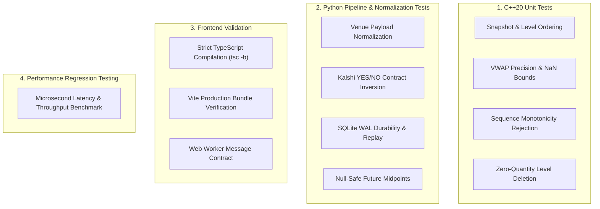

# Testing & Quality Assurance

PolyPulse employs a multi-tiered testing framework spanning C++20 engine verification, Python integration and normalization tests, and frontend TypeScript build validation.

---

## 1. Test Suite Architecture



---

## 2. Test Execution Commands

### 2.1 C++ Engine Tests
Verifies internal orderbook invariants, price level sorting, VWAP calculations, and boundary conditions.

```powershell
python scripts/build_engine.py --test
```
*Or compile and execute natively:*
```powershell
g++ -std=c++20 -O2 -I engine/include engine/src/orderbook.cpp engine/tests/orderbook_test.cpp -o engine/build/orderbook_test.exe
.\engine\build\orderbook_test.exe
```

#### What is Tested:
- Snapshot bid descending order (`bids_[0]` = Best Bid) and ask ascending order (`asks_[0]` = Best Ask).
- VWAP calculation accuracy within $10^{-9}$ floating point tolerance.
- Return of `std::isnan(vwap)` when requested volume exceeds total book depth.
- Sequence validation: updating with `seq <= current_seq` returns `false`.
- Out-of-bounds rejection: setting prices $> 10\,000$ or $< 0$ returns `false`.

---

### 2.2 Python Pipeline & Normalization Tests
Executes unit tests covering ctypes FFI interoperability, Polymarket and Kalshi normalization routines, decimal scaling, and SQLite persistence.

```powershell
python -m unittest discover -s tests -v
```

Expected output:
```text
test_engine_snapshot_update_and_vwap (test_pipeline.PipelineTests.test_engine_snapshot_update_and_vwap) ... ok
test_journal_restore_and_missing_markout (test_pipeline.PipelineTests.test_journal_restore_and_missing_markout) ... ok
test_venue_normalization (test_pipeline.PipelineTests.test_venue_normalization) ... ok

----------------------------------------------------------------------
Ran 3 tests in 0.045s

OK
```

#### Key Test Scenarios:
- **Kalshi Normalization**: Inverting NO contracts at price `0.53` into equivalent YES asks at price `0.47` ($10\,000 - 5300 = 4700$).
- **Polymarket Message Unpacking**: Parsing list and dictionary payloads, handling `"BUY"` and `"SELL"` string directives.
- **Precision Validation**: Rejection of inputs exceeding 4 decimal places of fractional precision.
- **Journal Recovery**: Initializing a fresh `MarketState` instance from a pre-existing SQLite journal and verifying that the restored in-memory book matches the last recorded state.
- **Markout Null Safety**: Asserting that querying future midpoints at $t + 60\text{s}$ returns `None` when observations do not yet exist.

---

### 2.3 Frontend TypeScript & Build Verification
Validates strict type-checking and builds the production bundle for the React terminal.

```powershell
cd frontend
npm run build
```

Expected output:
```text
> polypulse-terminal@0.1.0 build
> tsc -b && vite build

vite v6.4.5 building for production...
transforming...
✓ 1578 modules transformed.
rendering chunks...
computing gzip size...
dist/assets/stream.worker-BGZ0EJOM.js    0.14 kB
dist/index.html                          0.37 kB │ gzip:  0.27 kB
dist/assets/index-BHBz4AOc.css          13.25 kB │ gzip:  3.59 kB
dist/assets/index-DIgiWLFl.js          252.51 kB │ gzip: 77.13 kB
✓ built in 5.15s
```

---

### 2.4 End-to-End Microbenchmark Validation
Executes the microbenchmark harness to verify performance stability against throughput and latency regressions:

```powershell
python scripts/benchmark.py
```
